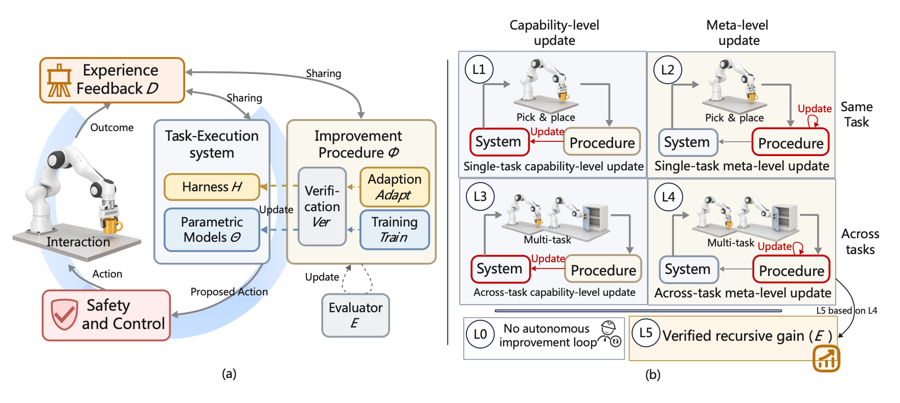
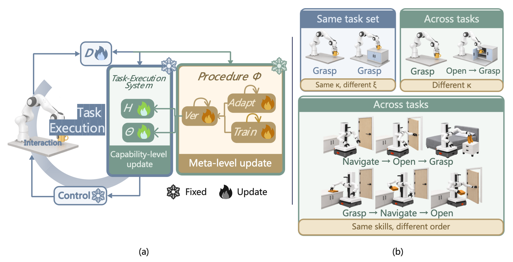
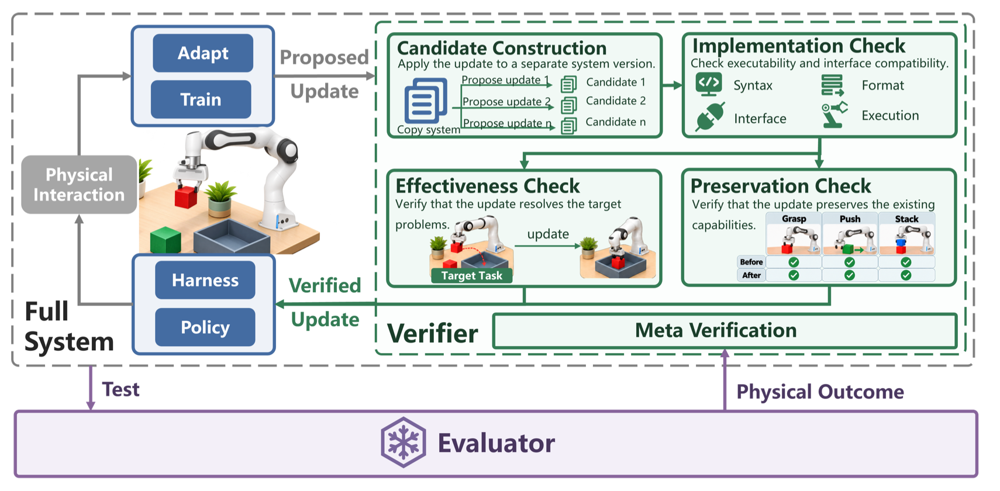

<h1><em>Physical RSI</em></h1>

<strong>Physical Recursive Self-Improvement</strong>

<em>From adaptation to inherited improvement.</em>

A paper-aligned, evidence-auditable map of recursive improvement in embodied systems.

  
  
  
  

  <a href="#the-boundary">Boundary</a> &nbsp;|&nbsp;
  <a href="#capability-map">L1-L5</a> &nbsp;|&nbsp;
  <a href="#featured-evidence-register">Evidence register</a> &nbsp;|&nbsp;
  <a href="#three-views-of-one-system">Research map</a> &nbsp;|&nbsp;
  <a href="#paper-catalog">Paper catalog</a> &nbsp;|&nbsp;
  <a href="docs/paper-reference-index.md">All references</a>

  

<em>Life is not repetition, but creation. Duration carries the whole of reality: a boundless river flowing toward a horizon with no predetermined end.</em> 
Darwin's <a href="https://commons.wikimedia.org/wiki/File:Darwin_Tree_1837.png">first evolutionary tree</a> (1837), beside Haeckel's <a href="https://commons.wikimedia.org/wiki/File:Pedigree_of_man_(Haeckel_1874).jpg"><em>Pedigree of Man</em></a> (1874). Both works are public domain.

## From Evolution to Physical RSI <a href="#readme-top">top</a>

Natural evolution did not become powerful because organisms changed once. Variation mattered
because selection acted on it, and inheritance carried the consequences forward. Across
generations, the environment became part of the history of what life could become.

Physical RSI asks whether an embodied artificial system can form an engineered counterpart to
this chain. Physical interaction supplies experience, verification determines which changes are
admitted, and inheritance returns accepted changes to the next improvement cycle.

> **Can the world change not only what a machine does, but how it produces its next
> improvement?**

The analogy deliberately stops there. Natural selection does not owe us a protected objective,
an audit trail, or a matched resource budget. An engineered recursive system does. A robot may
collect more data, recover from a failed grasp, or fine-tune a policy after deployment, but these
remain forms of adaptation until a retained change reaches the mechanism that generates,
evaluates, or selects later updates. The recursion becomes *physical* only when real interaction
has a causal role in deciding what mechanism changes or survives.

This repository is for **Physical Recursive Self-Improvement** research, where we study how
physical interaction can drive retained changes in embodied systems and the processes that improve
them. It follows the evidence boundaries of the accompanying paper and serves as a reading map,
not a leaderboard: labels such as "self-improving," "autonomous," or "lifelong" are not treated as
evidence on their own.

This repository is actively maintained. If an author would prefer not to have a paper listed here,
please contact <shangding.gu@berkeley.edu>. Constructive comments, corrections, and suggestions are
welcome.

You are also welcome to update the collection. To suggest a missing paper or correct an existing
entry, you can:

- fork this repository and open a pull request;
- [report an issue](https://github.com/SAIL-Research-Lab/Physical-RSI/issues);
- or email <shangding.gu@berkeley.edu>.

**Content**

The repository is organized to be read from definitions and evidence to methods, papers, and
open questions:

- [From Evolution to Physical RSI](#from-evolution-to-physical-rsi)
- [The Boundary](#the-boundary)
- [Capability Map](#capability-map)
- [Featured Evidence Register](#featured-evidence-register)
- [Harness Adaptation, Training, and Verification](#three-views-of-one-system)
- [Paper Catalog](#paper-catalog)
- [Open Questions](#open-questions)
- [License](#license)

> **Version note.** The sections below follow `IEEE_TPAMI__Physical_RSI-33.pdf` (12 October 2026).
> The opening introduction and badges are retained from the earlier README; their L1–L5 taxonomy,
> real-only grounding language, and bibliography counts should not be read as claims about this snapshot.
> The current framework and coverage are specified below.

---

## The Boundary <a href="#readme-top">top</a>

The paper separates the **task-execution system** from the **procedure that improves it**.
Their roles, rather than whether they are implemented as code, text, or weights, determine what
has changed and which claim the evidence supports.

| Object | Role in the improvement system |
| --- | --- |
| **Execution system `M = (Θ, H)`** | Learned execution models `Θ` and the model-external harness `H`: prompts, memory, skills, tools, and orchestration. |
| **Improvement procedure `Φ = (Adapt, Train, Ver)`** | Harness adaptation, data preparation and model training, and verification of candidate updates. These stages may themselves be revised. |
| **Experience `D`** | Execution records and improvement histories, including attempted changes and their outcomes. |
| **Protected evaluation `E/Q`** | Tasks and scoring rules outside `Φ`, used to evaluate the systems it produces and to judge revisions of `Ver`. |

  

<strong>Figure 1.</strong> Task execution, the improvement procedure, safety and control, and the L0–L5 framework.

Four claims that are often collapsed should be kept separate:

| Claim | What must be shown |
| --- | --- |
| **Inheritance** | An accepted change persists beyond its originating episode and is used later. |
| **Retained capability gain** | The inherited change contributes to better later task performance. |
| **Meta-level self-inheritance** | The procedure produces a revision of its own stages, which is retained and used in later improvement. |
| **Recursive gain across tasks** | Successive revised procedures produce better subsequent systems than their predecessors from matched starting systems and experience, under equal budgets and protected evaluation. |

Replanning within an execution is not inheritance. Revising a procedure is not proof that it
improves more effectively. A persuasive comparison accounts for robot trials, resets, hardware wear,
compute, search, and human effort—not only the final successor's score.

**Grounding and deployment are different records.** Definitions 1–2 and Section 5.2 allow grounding
through physics simulation or real interaction. Simulated feedback is not evidence of hardware
safety; learned-model imagination alone does not meet the grounding condition. Deploying a frozen
result on a robot does not retroactively make its earlier revisions depend on real-robot feedback.

## Capability Map <a href="#readme-top">top</a>

L1–L4 cross two dimensions: **the update target** and **the scope of the demonstrated gain**.
They are not a simple ladder from human assistance to autonomy. L5 builds on L4 and adds verified
recursive gain. A level applies to a specified improvement workflow and evaluation protocol—not
to every experiment in a paper.

| Scope of gain | Capability-level update to `M = (Θ, H)` | Meta-level update to `Φ` |
| --- | --- | --- |
| **Same task** | **L1:** an autonomously inherited capability update yields a retained same-task gain, with the improvement procedure fixed. | **L2:** an autonomously revised and inherited procedure is reused for same-task improvement, with retained capability gain. |
| **Across tasks** | **L3:** source-task experience produces an inherited capability change that contributes to target-task gain, with the improvement procedure fixed. | **L4:** a procedure revision formed through source-task improvement is inherited and used for improvement across tasks, with retained capability gain. |

- **L0 — no autonomous retained-improvement loop in the assessed workflow.** This includes
  execution-only correction and, under the paper's autonomy rule, retained updates that depend on
  human intervention or labeling during improvement.
- **L5 — verified recursive gain across tasks.** Beyond L4, successive inherited revisions of `Φ`
  must produce better subsequent improvements than their predecessors from matched starting
  systems and experience, under equal budgets and protected evaluation.

**Procedure change is not sufficient for L5.** Revising training code, a curriculum, or an acceptance
rule establishes a changed mechanism only when the revision is retained and used. Its superiority
requires a separate comparison of the subsequent systems produced by the old and new procedures.
The manuscript's Figure 3 reports **no confirmed L5 case among its selected systems**.

### What counts as another task?

The manuscript describes a task through its required **skill sequence `κ`** and its **instance
parameters `ξ`**. A change in object pose or scene difficulty does not establish across-task transfer
if the required sequence remains unchanged. A new skill or a new ordering or composition of existing
skills changes `κ`.

- Grasping a cup from two different exposed positions: potentially the **same task**, with different `ξ`.
- Grasping a cup versus opening a cabinet and then grasping it: **different tasks**.
- `navigate → open → grasp` versus `grasp → navigate → open`: **different skill sequences**.

  

<strong>Manuscript Figure 2.</strong> Update targets and task identity. New scenes or embodiments should not automatically be counted as new tasks.

Cross-task evidence must also show that the retained source change is actually used and contributes
to target performance. Running the same fixed procedure independently on many tasks is not enough.

## Featured Evidence Register <a href="#readme-top">top</a>

The entries below follow the manuscript's selected protocols in Section 2.3 and Figure 3.
They separate the inherited object from the setting that supplies its feedback. The register is
selective and does not replace the underlying experiments or their autonomy conditions.

| Selected workflow | Reading under the current framework | Evidence and boundary |
| --- | --- | --- |
| [ConRFT](https://arxiv.org/abs/2502.05450), operator-assisted learning | **L0 reference workflow** | Human corrections contribute to retained learning. This is useful robot improvement, but not autonomous improvement under the manuscript's level-assignment rule. |
| [DoReMi](https://sites.google.com/view/doremi-paper), execution recovery | **L0 reference workflow** | Detecting a mismatch and replanning during execution does not by itself establish a retained update to `M` or `Φ`. |
| [SOAR](https://arxiv.org/abs/2407.20635) and [SELFI](https://proceedings.mlr.press/v270/hirose25a.html), autonomous robot learning | **L1 in the selected workflows** | Real-robot experience supports retained capability updates. A new scene or further training round is not automatically a new `κ` or an updated improvement procedure. |
| [ENPIRE](https://arxiv.org/abs/2606.19980), pin-insertion training-code revision | **L2 in the selected same-task protocol** | Robot outcomes guide revisions to training code and recipes. The selected experiment does not establish across-task procedure improvement or the successive matched gains required for L5. |
| [ASPIRE](https://arxiv.org/abs/2607.00272), retained library transfer | **L3 in the selected simulation protocol** | Guidance accumulated on LIBERO-90 is applied to held-out long-horizon tasks without further debugging or task-specific library updates. The retained library belongs to `H`; separate real-robot transfer does not change the source of its discovery feedback. |
| [RPG](https://arxiv.org/abs/2610.02204), skill and prompt improvement | **L3 in the manuscript's selected workflow** | Simulation practice updates the execution system, which is then frozen for real deployment. Retaining an improved skill library is not the same as revising the method that builds the library. |
| [Hyperagents](https://arxiv.org/html/2603.19461v1), transferable meta-improvement | **L4 comparator in Figure 3; methodological precedent** | The manuscript uses this work to discuss editable improvement procedures and transfer. Its digital/meta-level evidence should not be relabeled as a demonstration of real-robot L5. |

**Autonomy needs its own record.** Human setup, scene resets, hardware repair, and authorization for
physical operation should be reported separately from human labeling, corrective intervention,
code edits, or update selection. The latter can determine what is inherited and therefore affect
the level claim; the former do not change the level by themselves, but still contribute cost and risk.

## Harness Adaptation, Training, and Verification <a href="#readme-top">top</a>

Harness adaptation and model training are two pathways through the same improvement system.
Safety constrains both; verification decides what can be inherited; independent evaluation asks
whether the retained changes helped. Sections 3–6 organize these complementary roles.

### 1. Harness adaptation

The harness carries execution resources across tasks: memory, skill implementations, interfaces,
and orchestration or recovery logic. Its update loop connects physical evidence to later use:

> **execution evidence → diagnosis and edit scope → candidate change → verification → inheritance**

| Question | Update target | Representative work |
| --- | --- | --- |
| **What execution resource should change?** | Memory, programs, skills, prompts, or workflows in `H`. | [ASPIRE](https://arxiv.org/abs/2607.00272), [RPG](https://arxiv.org/abs/2610.02204), [RoboFoundry](https://arxiv.org/html/2609.32862v1), [KnowBody](https://arxiv.org/html/2609.28530v1) |
| **How should later harness changes be produced?** | The diagnosis, construction, or selection method in `Adapt`. | Digital precedents include [STOP](https://arxiv.org/pdf/2310.02304v3), [MemSkill](https://arxiv.org/abs/2602.02474v2), and [VERSE](https://arxiv.org/abs/2610.02616v1). |

Adding a skill changes an execution resource. Changing the method that discovers or selects future
skills targets the improvement procedure. Digital examples help explain this distinction; their
inclusion does not establish physical grounding.

### 2. Model training

Training connects collected and selected experience to inherited model updates:

> **experience preparation → IL / SSL / RL → model update → verification → later interaction**

The paper reviews data preparation, imitation learning, self-supervised learning, reinforcement
learning, and VLA, world, and reward models. [SOAR](https://arxiv.org/abs/2407.20635) and
[SELFI](https://proceedings.mlr.press/v270/hirose25a.html) illustrate continued robot learning;
[EmbodiRSI](https://arxiv.org/abs/2609.38905) and [F4R](https://arxiv.org/abs/2609.35575v2)
provide adaptation examples; [ENPIRE](https://arxiv.org/abs/2606.19980) illustrates training-code revision.

Better weights under a fixed objective do not establish a better improvement procedure. A reward
or world model used only during training may belong to `Φ`, but fitting it to a prescribed target is
not automatically meta-improvement. Identify a retained change to the objective, update rule,
curriculum, training configuration, or decision procedure, and assess its later effect.

### 3. Safety and control

Safety must be reassessed across updates, rather than checked only for the final policy.

| Decision | Required distinction |
| --- | --- |
| **Attempt a trial** | Check operating assumptions, action constraints, uncertainty, and feasible stopping or recovery. |
| **Accept an update** | Decide whether the candidate should be inherited; check affected interfaces, capabilities, and safeguards. |
| **Authorize operation** | Establish the conditions under which the system may operate physically; acceptance alone does not grant release. |
| **Assess accumulated risk** | Include rejected trials, resets, recovery, interventions, and hardware wear—not only successful execution. |

A safe final policy does not show that its learning process was safe. Earlier guarantees remain
usable only while their assumptions and statistical bounds remain valid. The paper reviews
component guarantees under stated conditions, not a safety guarantee for unrestricted Physical RSI.

### 4. Verification and evaluation

**Verification asks what may be retained. Evaluation asks what its later use achieved.**
Section 6 separates these roles: `Ver` belongs to `Φ`; protected `E/Q` assesses the resulting system.

  

<strong>Figure 10.</strong> Candidate construction, implementation, effectiveness and preservation checks, and the independent evaluator.

| Verification check | Deciding question |
| --- | --- |
| **Implementation validity** | Can the candidate run with the required syntax, interfaces, formats, and outputs? |
| **Repair effectiveness** | Does it address the targeted failure under the tested conditions? |
| **Capability preservation** | Does it retain earlier successful behavior and revalidate dependent knowledge? |
| **Meta-verification** | If `Ver` changes, do independent outcomes of the systems it accepts justify that revision? |

Passing an implementation check establishes testability, not improvement. More accepted updates
under a revised verifier do not establish that the verifier is better.

Improvement evaluation follows three questions:

1. **Performance and retention:** what improves over rounds, and which earlier capabilities remain?
2. **Attribution and transfer:** what retained change causes the gain, and does it transfer to a new `κ`?
3. **Efficiency and autonomy:** what interaction, compute, human assistance, and physical risk produced it?

For L5, compare successive versions of `Φ` from the same starting execution system and initial
experience, with equal budgets, matched safety and stopping conditions, and protected across-task
evaluation. Use repeated trials and uncertainty estimates. Report the cost of developing a revision
separately from the cost of using it to produce later improvements.

Two forms of independence matter. **Control independence** prevents a candidate from changing or
bypassing the protected evaluator. **Information independence** prevents adaptive feedback from
turning the final test into an optimization target. Keeping `E/Q` outside `Φ` is not enough if its
decisions repeatedly guide later proposals. Use fresh evidence or appropriate statistical correction;
if the evaluation set changes, retain a fixed anchor or re-evaluate earlier generations.

### 5. Benchmark resources

Section 6.3 and Table 4 group resources by what they assess, not by an assigned RSI level.
This selected map also includes process-oriented resources discussed in the text.

| Family | Evaluation focus | Representative resources |
| --- | --- | --- |
| **Embodied** | Task performance and generalization | Meta-World, LIBERO, ManiSkill3, BEHAVIOR-1K, RoboCasa365 |
| **Embodied** | Robustness and physical evaluation | LIBERO-PRO, SIMPLER, RoboTwin, RoboArena |
| **Embodied** | Feedback and evaluation reliability | FailBench, RoboRewardBench, WorldEval, dWorldEval, SC3-Eval, RBM-EVAL |
| **Embodied** | Robot engineering and development | CaP-Bench within CaP-X, EmboCoach-Bench as named in the manuscript, RLE-Bench |
| **Primarily digital** | AI research, training algorithms, and data strategies | AI4AI-Bench, RSIBench-Data, MLAgentBench, MLE-bench, MLGym-Bench, MLRC-Bench, RE-Bench |
| **Primarily digital** | Method or harness development and retained experience | RSI-Exam, HarnessDev, PAST-Bench |

These resources probe different parts of the problem. An iterative agent benchmark is not, by that
fact alone, a complete Physical RSI evaluation. Verified recursive gain across tasks under matched
conditions remains a gap identified in the manuscript's reviewed resources.

## Paper Catalog <a href="#readme-top">top</a>

Browse by **research topic and resource type**, not by the section in which a paper is cited.
Each work has one primary home; a category is a reading aid, not a capability-level assignment.
The **116-entry selected catalog** retains the earlier collection and representative additions from v33;
it is not the manuscript's complete bibliography or a full primary-paper audit.
Linked titles, authors, and cited years retain the compact style of the original collection.
Entries are ordered by cited year within each list; preprint and publication years may differ.

**Browse:** [Robot learning](#catalog-robot-learning) ·
[Agent harnesses](#catalog-agent-harnesses) ·
[Learning signals and world models](#catalog-learning-resources) ·
[Recursive and meta-improvement](#catalog-meta-improvement) ·
[Safety and assurance](#catalog-safety) ·
[Verification methods](#catalog-verification) ·
[Benchmarks and evaluation resources](#catalog-benchmarks)

**Classification rules.** Benchmark, shared-dataset, and evaluation-platform entries are collected
under **Benchmarks and Evaluation Resources**, regardless of where they appear in the manuscript.
For a paper contributing both a method and a benchmark, its benchmark role takes priority here;
the resource name is noted where it differs from the paper title. Safety mechanisms, deployment
checks, failure monitors, and integrity safeguards belong under **Safety and Assurance**; a safety
benchmark would still belong under benchmarks. Verifier construction and use belong under
**Verification Methods** unless the entry is included as an evaluation resource or safeguard.
Other works are grouped by their main learning, execution, or meta-improvement focus.

The [reference index](docs/paper-reference-index.md) remains an earlier-snapshot resource, not a
complete bibliography of v33.

### Robot Learning and Adaptation Systems

Robot policy learning, autonomous practice, feedback-driven adaptation, and end-to-end improvement systems.

- [ENPIRE: Agentic Robot Policy Self-Improvement in the Real World](https://arxiv.org/abs/2606.19980) by Wenli Xiao et al. 2026.
- [Visual Verification Enables Inference-Time Steering and Autonomous Policy Improvement](https://arxiv.org/abs/2606.18247) by Mingtong Zhang and Dhruv Shah. 2026.
- [HARBOR: A Harness Framework for Agentic Robot Reinforcement Learning](https://arxiv.org/abs/2606.08610) by Zechu Li et al. 2026.
- [Self-Evolving Learning for Embodied AI with Criticality Model](https://arxiv.org/abs/2607.28251) by Linxuan He et al. 2026.
- [Practice Makes Policies: Bootstrapping and Consolidating Robotic Capabilities from Zero Human Demonstrations](https://arxiv.org/abs/2607.26809) by Jialiang Li et al. 2026.
- [FAR: Failure-Aware Retry for Test-Time Recovery and Continual Policy Improvement](https://arxiv.org/abs/2607.01111) by Haoran Hao et al. 2026.
- [EmbodiRSI: Recursive Self-Improvement for Data-Efficient Robot Adaptation](https://arxiv.org/abs/2609.38905) by Haoran Lang et al. 2026.
- [F4R: Failure-Driven Recognition, Reconstruction, Refinement, and Redeployment for Continual Robot Self-Improvement](https://arxiv.org/abs/2609.35575v2) by Zhuoyuan Yu et al. 2026.
- [Robust Finetuning of Vision-Language-Action Robot Policies via Parameter Merging](https://arxiv.org/abs/2512.08333) by Yajat Yadav et al. 2026.
- [ConRFT: A Reinforced Fine-Tuning Method for VLA Models via Consistency Policy](https://arxiv.org/abs/2502.05450) by Yuhui Chen et al. 2025.
- [SELFI: Autonomous Self-Improvement with RL for Vision-Based Navigation around People](https://proceedings.mlr.press/v270/hirose25a.html) by Noriaki Hirose et al. 2025.
- [Autonomous Improvement of Instruction Following Skills via Foundation Models](https://arxiv.org/abs/2407.20635) by Zhiyuan Zhou et al. 2024.
- [RoboCat: A Self-Improving Generalist Agent for Robotic Manipulation](https://openreview.net/forum?id=vsDnJ2WR4x) by Konstantinos Bousmalis et al. 2024.
- [Self-Improving Robots: End-to-End Autonomous Visuomotor Reinforcement Learning](https://proceedings.mlr.press/v229/sharma23b.html) by Archit Sharma et al. 2023.

### Agent Harnesses, Skills, and Task Execution

Skill libraries, tool use, planning, execution-time correction, and editable agent scaffolds.
Safety-specific monitors are collected under [Safety and Assurance](#catalog-safety), while
simulation and reward-generation methods are collected under [Learning Signals](#catalog-learning-resources).

- [ASPIRE: Agentic Skills Discovery for Robotics](https://arxiv.org/abs/2607.00272) by Runyu Lu et al. 2026.
- [Self-Evolving Embodied Agents via Skill-Harness Evolution](https://arxiv.org/abs/2608.11350) by Peidong Wang et al. 2026.
- [Reconstruct, Practice, Go Real: Guided Self-Improvement for Embodied Agents](https://arxiv.org/abs/2610.02204) by Yen-Jen Wang et al. 2026.
- [RoboFoundry: System-as-Policy Evolution for Self-Learning Embodied Agents](https://arxiv.org/html/2609.32862v1) by Jingsong Liang et al. 2026.
- [HarnessPAI: An Evolving Harness for Physical AI](https://arxiv.org/html/2609.29166v1) by Xin Wang et al. 2026.
- [Know Your Body: A Harness for Direct and Self-Improving Robot Control with VLMs](https://arxiv.org/html/2609.28530v1) by Zeyu Lou et al. 2026.
- [Zetta: An Efficient Closed-Loop Embodied Harness for Self-Evolving Physical Intelligence](https://arxiv.org/abs/2608.16590) by Xin Ding et al. 2026.
- [Evolve Vision-Language-Action Model into an Agent with On-the-Fly Tool Use](https://arxiv.org/abs/2608.14047) by Yi Ding et al. 2026.
- [Grounded Vision-Language Interpreter for Long-Horizon Bimanual Task and Motion Planning](https://arxiv.org/abs/2506.03270) by Jeremy Siburian et al. 2025.
- [DoReMi: Grounding Language Model by Detecting and Recovering from Plan-Execution Misalignment](https://sites.google.com/view/doremi-paper) by Yanjiang Guo et al. 2024.
- [Open-World Task and Motion Planning via Vision-Language Model Generated Constraints](https://arxiv.org/abs/2411.08253) by Nishanth Kumar et al. 2024.
- [Trust the PRoC3S: Solving Long-Horizon Robotics Problems with LLMs and Constraint Satisfaction](https://arxiv.org/abs/2406.05572) by Aidan Curtis et al. 2024.
- [REFLECT: Summarizing Robot Experiences for Failure Explanation and Correction](https://arxiv.org/abs/2306.15724) by Zeyi Liu, Arpit Bahety, and Shuran Song. 2023.
- [Code as Policies: Language Model Programs for Embodied Control](https://arxiv.org/abs/2209.07753) by Jacky Liang et al. 2022.
- [Do As I Can, Not As I Say: Grounding Language in Robotic Affordances](https://arxiv.org/abs/2204.01691) by Michael Ahn et al. 2022.

### Learning Signals, Data Generation, and World Models

Reward design, synthetic experience, simulation, and world models used to improve learning.
Shared dataset resources and evaluation-oriented world-model entries are collected under
[Benchmarks and Evaluation Resources](#catalog-benchmarks).

- [Motus2: A Self-Evolving General World Model for Dexterous Manipulation](https://arxiv.org/abs/2608.30237) by Hongzhe Bi et al. 2026.
- [DenseReward: Dense Reward Learning via Failure Synthesis for Robotic Manipulation](https://arxiv.org/abs/2607.13033) by Yu Fang et al. 2026.
- [Robot Self-Improvement via Human-Video Dynamics Models](https://arxiv.org/abs/2606.21406) by Hanzhi Chen et al. 2026.
- [SARM2: Multi-Task Stage Aware Reward Modeling for Self Improving Robotic Manipulation](https://arxiv.org/abs/2606.10305) by Qianzhong Chen et al. 2026.
- [RISE: Self-Improving Robot Policy with Compositional World Model](https://arxiv.org/abs/2602.11075) by Jiazhi Yang et al. 2026.
- [GenSim2: Scaling Robot Data Generation with Multi-Modal and Reasoning LLMs](https://arxiv.org/abs/2410.03645) by Pu Hua et al. 2024.
- [DrEureka: Language Model Guided Sim-to-Real Transfer](https://arxiv.org/abs/2406.01967) by Yecheng Jason Ma et al. 2024.
- [RoboGen: Towards Unleashing Infinite Data for Automated Robot Learning via Generative Simulation](https://arxiv.org/abs/2311.01455) by Yufei Wang et al. 2024.
- [Eureka: Human-Level Reward Design via Coding Large Language Models](https://arxiv.org/abs/2310.12931) by Yecheng Jason Ma et al. 2024.

### Recursive and Meta-Improvement Methods

Methods for revising algorithms, code, memory, training procedures, or the improvement process itself.
This group includes digital and theoretical work; inclusion is not evidence of physical RSI.
Evaluator-learning methods appear under [Verification Methods](#catalog-verification), and
benchmarks for these systems appear under [Benchmarks and Evaluation Resources](#catalog-benchmarks).

- [SBCO: Self-Supervised, Verifier-Grounded Harness Optimization for Planning Agents](https://arxiv.org/abs/2608.10157) by Vivek Kulkarni et al. 2026.
- [EvoTrainer: Co-Evolving LLM Policies and Training Harnesses for Autonomous Agentic Reinforcement Learning](https://arxiv.org/abs/2606.03108) by Guhong Chen et al. 2026.
- [GEAR: Genetic AutoResearch for Agentic Code Evolution](https://arxiv.org/abs/2605.13874) by Ahmadreza Jeddi et al. 2026.
- [Hyperagents](https://arxiv.org/html/2603.19461v1) by Jenny Zhang et al. 2026.
- [Learning to Discover at Test Time](https://arxiv.org/abs/2601.16175) by Mert Yuksekgonul et al. 2026.
- [VERSE: Verified Self-Evolving Optimizer for Agent Harnesses](https://arxiv.org/abs/2610.02616v1) by Zekai Wang et al. 2026.
- [MemSkill: Learning and Evolving Memory Skills for Self-Evolving Agents](https://arxiv.org/abs/2602.02474v2) by Haozhen Zhang et al. 2026.
- [Darwin Gödel Machine: Open-Ended Evolution of Self-Improving Agents](https://arxiv.org/abs/2505.22954) by Jenny Zhang et al. 2025.
- [CALM: Co-Evolution of Algorithms and Language Model for Automatic Heuristic Design](https://arxiv.org/abs/2505.12285) by Ziyao Huang et al. 2025.
- [Algorithm Discovery with LLMs: Evolutionary Search Meets Reinforcement Learning](https://arxiv.org/abs/2504.05108) by Anja Surina et al. 2025.
- [Godel Agent: A Self-Referential Agent Framework for Recursively Self-Improvement](https://aclanthology.org/2025.acl-long.1354/) by Xunjian Yin et al. 2025.
- [Self-Taught Optimizer (STOP): Recursively Self-Improving Code Generation](https://arxiv.org/pdf/2310.02304v3) by Eric Zelikman et al. 2024.
- [Godel Machines: Fully Self-Referential Optimal Universal Self-Improvers](https://doi.org/10.1007/978-3-540-68677-4_7) by Jurgen Schmidhuber. 2007.

### Safety, Assurance, and Failure Monitoring

Safety-related works are collected here across training, control, execution, deployment, and
evaluation integrity. Failure detection is not a safety guarantee; digital reward-integrity
safeguards are not physical-safety evidence. Benchmark resources remain in the benchmark group.

#### Learning, Control, and Integrity Safeguards

- [PACT: Self-Evolving Physical Safety Alignment for Diffusion Policies in Embodied Manipulation](https://arxiv.org/abs/2606.08414) by Lingxuan Wu et al. 2026.
- [BenchShield: Formal Model-Backed Instrumentation for Reward Integrity in LLM-Agent Evaluation Infrastructure](https://arxiv.org/abs/2609.11028) by Shenghan Zheng et al. 2026.
- [Safe Continual Domain Adaptation after Sim2Real Transfer of Reinforcement Learning Policies in Robotics](https://arxiv.org/abs/2503.10949) by Josip Josifovski et al. 2025.
- [Preventing Undesirable Behavior of Intelligent Machines](https://doi.org/10.1126/science.aag3311) by Philip S. Thomas et al. 2019.
- [Control Barrier Function Based Quadratic Programs for Safety Critical Systems](https://doi.org/10.1109/TAC.2016.2638961) by Aaron D. Ames et al. 2017.
- [Constrained Policy Optimization](https://proceedings.mlr.press/v70/achiam17a.html) by Joshua Achiam et al. 2017.
- [High Confidence Policy Improvement](https://proceedings.mlr.press/v37/thomas15.html) by Philip S. Thomas et al. 2015.

#### Failure Monitoring and Deployment Checks

- [VLA-FAIL: Efficient Task Failure Detection for Finetuned Vision-Language-Action Models](https://arxiv.org/abs/2606.21386) by Florian Seligmann et al. 2026.
- [ROBOGATE: Adaptive Failure Discovery for Safe Robot Policy Deployment via Two-Stage Boundary-Focused Sampling](https://arxiv.org/abs/2603.22126) by Azuki Kim. 2026.
- [SAFE: Multitask Failure Detection for Vision-Language-Action Models](https://arxiv.org/abs/2506.09937) by Qiao Gu et al. 2025.
- [Unpacking Failure Modes of Generative Policies: Runtime Monitoring of Consistency and Progress](https://proceedings.mlr.press/v270/agia25a.html) by Christopher Agia et al. 2025.
- [Code-as-Monitor: Constraint-Aware Visual Programming for Reactive and Proactive Robotic Failure Detection](https://arxiv.org/abs/2412.04455) by Enshen Zhou et al. 2024.

### Verification and Evaluation Methods

Verifier design, test-time verification, and learned evaluators. This group separates methods
for constructing or using judgments from benchmark resources for testing those judgments;
safety-specific monitors remain in [Safety and Assurance](#catalog-safety).

#### Robot Policy Verification

- [No Free Checker: A Survey of Verifiers for Robot Policies](https://arxiv.org/abs/2609.09250) by Yang Wan et al. 2026.
- [RoVer: Robot Reward Model as Test-Time Verifier for Vision-Language-Action Model](https://arxiv.org/abs/2510.10975) by Mingtong Dai et al. 2025.
- [RoboMonkey: Scaling Test-Time Sampling and Verification for Vision-Language-Action Models](https://arxiv.org/abs/2506.17811) by Jacky Kwok et al. 2025.

#### Evaluator Learning and Self-Verification in Digital Systems

- [Self-Trained Verification for Training- and Test-Time Self-Improvement](https://arxiv.org/abs/2605.30290) by Chen Henry Wu and Aditi Raghunathan. 2026.
- [Self-Taught Evaluators](https://arxiv.org/abs/2408.02666) by Tianlu Wang et al. 2024.
- [Meta-Rewarding Language Models: Self-Improving Alignment with LLM-as-a-Meta-Judge](https://arxiv.org/abs/2407.19594) by Tianhao Wu et al. 2024.

### Benchmarks, Datasets, and Evaluation Resources

A single home for benchmark-related references, regardless of where they appear in the manuscript.
The **47 entries** below cover all **38 resources named in v33 Table 4**, plus nine other benchmark,
dataset, and evaluation-resource entries. These include GemBench from the task discussion, DROID
from the introduction, and HarnessDev, RSI-Exam, and PAST-Bench from Section 6.3.
See the [resource-to-paper coverage audit](docs/v33-benchmark-coverage.md) for the complete mapping
and the distinction between Table 4 entries and additional resources.

The subgroups distinguish task suites and datasets, robustness and physical-world evaluation,
feedback reliability, robot development, and digital research. Supporting frameworks and shared
datasets are included explicitly: not every entry is a standalone benchmark. A paper may contribute
both a method and a benchmark; resource aliases identify the benchmark without duplicating the paper.
Cited years follow v33 and may differ from first preprint dates.

#### Robot Task Suites and Shared Datasets

- [RoboCasa365: A Large-Scale Simulation Framework for Training and Benchmarking Generalist Robots](https://arxiv.org/abs/2603.04356) by Soroush Nasiriany et al. 2026.
- [RoboLab: A High-Fidelity Simulation Benchmark for Analysis of Task Generalist Policies](https://arxiv.org/abs/2604.09860) by Jenai Xuning Yang et al. 2026.
- [EmbodiedBench: Comprehensive Benchmarking Multi-modal Large Language Models for Vision-Driven Embodied Agents](https://proceedings.mlr.press/v267/yang25f.html) by Rui Yang et al. 2025.
- [ManiSkill3: GPU Parallelized Robotics Simulation and Rendering for Generalizable Embodied AI](https://arxiv.org/abs/2410.00425) by Stone Tao et al. 2025.
- [Towards Generalizable Vision-Language Robotic Manipulation: A Benchmark and LLM-guided 3D Policy](https://arxiv.org/abs/2410.01345) by Ricardo Garcia et al. 2025. *Benchmark resource: GemBench; discussed in v33 Section 2 (p. 10).*
- [VLABench: A Large-Scale Benchmark for Language-Conditioned Robotics Manipulation with Long-Horizon Reasoning Tasks](https://openaccess.thecvf.com/content/ICCV2025/html/Zhang_VLABench_A_Large-Scale_Benchmark_for_Language-Conditioned_Robotics_Manipulation_with_Long-Horizon_ICCV_2025_paper.html) by Shiduo Zhang et al. 2025.
- [BEHAVIOR-1K: A Human-Centered, Embodied AI Benchmark with 1,000 Everyday Activities and Realistic Simulation](https://arxiv.org/abs/2403.09227) by Chengshu Li et al. 2024.
- [DROID: A Large-Scale In-The-Wild Robot Manipulation Dataset](https://www.roboticsproceedings.org/rss20/p120.html) by Alexander Khazatsky et al. 2024. *Shared dataset cited in the v33 introduction; not a Table 4 benchmark.*
- [Open X-Embodiment: Robotic Learning Datasets and RT-X Models](https://arxiv.org/abs/2310.08864) by the Open X-Embodiment Collaboration. 2024.
- [LIBERO: Benchmarking Knowledge Transfer for Lifelong Robot Learning](https://arxiv.org/abs/2306.03310) by Bo Liu et al. 2023.
- [VIMA: Robot Manipulation with Multimodal Prompts](https://proceedings.mlr.press/v202/jiang23b.html) by Yunfan Jiang et al. 2023. *Benchmark resource: VIMA-Bench.*
- [CALVIN: A Benchmark for Language-Conditioned Policy Learning for Long-Horizon Robot Manipulation Tasks](https://arxiv.org/abs/2112.03227) by Oier Mees et al. 2022.
- [What Matters in Learning from Offline Human Demonstrations for Robot Manipulation](https://arxiv.org/abs/2108.03298) by Ajay Mandlekar et al. 2021. *Resource: robomimic.*
- [Meta-World: A Benchmark and Evaluation for Multi-Task and Meta Reinforcement Learning](https://proceedings.mlr.press/v100/yu20a.html) by Tianhe Yu et al. 2020.
- [robosuite: A Modular Simulation Framework and Benchmark for Robot Learning](https://arxiv.org/abs/2009.12293) by Yuke Zhu et al. 2020.
- [RLBench: The Robot Learning Benchmark & Learning Environment](https://arxiv.org/abs/1909.12271) by Stephen James et al. 2019.

#### Robustness and Physical-World Evaluation

- [RoboDojo: A Unified Sim-and-Real Benchmark for Comprehensive Evaluation of Generalist Robot Manipulation Policies](https://arxiv.org/abs/2607.04434) by Tianxing Chen et al. 2026.
- [RoboTwin 2.0: A Scalable Data Generator and Benchmark with Strong Domain Randomization for Robust Bimanual Robotic Manipulation](https://proceedings.mlr.press/v306/chen26j.html) by Tianxing Chen et al. 2026.
- [VLA-Arena: An Open-Source Framework for Benchmarking Vision-Language-Action Models](https://proceedings.mlr.press/v306/zhang26cp.html) by Borong Zhang et al. 2026.
- [AutoEval: Autonomous Evaluation of Generalist Robot Manipulation Policies in the Real World](https://arxiv.org/abs/2503.24278v1) by Zhiyuan Zhou et al. 2025.
- [LIBERO-Plus: In-depth Robustness Analysis of Vision-Language-Action Models](https://arxiv.org/abs/2510.13626) by Senyu Fei et al. 2025.
- [LIBERO-PRO: Towards Robust and Fair Evaluation of Vision-Language-Action Models Beyond Memorization](https://arxiv.org/abs/2510.03827) by Xueyang Zhou et al. 2025.
- [REALM: A Real-to-Sim Validated Benchmark for Generalization in Robotic Manipulation](https://arxiv.org/abs/2512.19562) by Martin Sedlacek et al. 2025.
- [RoboArena: Distributed Real-World Evaluation of Generalist Robot Policies](https://proceedings.mlr.press/v305/atreya25a.html) by Pranav Atreya et al. 2025.
- [RoboTwin: Dual-Arm Robot Benchmark with Generative Digital Twins](https://arxiv.org/abs/2504.13059) by Yao Mu et al. 2025.
- [Evaluating Real-World Robot Manipulation Policies in Simulation](https://arxiv.org/abs/2405.05941) by Xuanlin Li et al. 2024. *Evaluation resource: SIMPLER.*
- [THE COLOSSEUM: A Benchmark for Evaluating Generalization for Robotic Manipulation](https://arxiv.org/abs/2402.08191) by Wilbert Pumacay et al. 2024.

#### Feedback Reliability and Model-Based Evaluation

- [dWorldEval: Scalable Robotic Policy Evaluation via Discrete Diffusion World Model](https://arxiv.org/abs/2604.22152) by Yaxuan Li et al. 2026.
- [FailBench: How Reliable Are VLMs at Judging Robot Task Success?](https://arxiv.org/abs/2609.03611v1) by Zaruhi Navasardyan et al. 2026.
- [GigaWorld-1: A Roadmap to Build World Models for Robot Policy Evaluation](https://arxiv.org/abs/2607.02642) by the GigaWorld Team. 2026.
- [Robometer: Scaling General-Purpose Robotic Reward Models via Trajectory Comparisons](https://arxiv.org/abs/2603.02115) by Anthony Liang et al. 2026. *Benchmark resource in v33: RBM-EVAL.*
- [RoboReward: General-Purpose Vision-Language Reward Models for Robotics](https://arxiv.org/abs/2601.00675) by Tony Lee et al. 2026. *Benchmark resource in v33: RoboRewardBench.*
- [SC3-Eval: Evaluating Robot Foundation Models via Self-Consistent Video Generation](https://arxiv.org/abs/2606.18610) by Wei-Cheng Tseng et al. 2026.
- [WorldEval: World Model as Real-World Robot Policies Evaluator](https://arxiv.org/abs/2505.19017) by Yaxuan Li et al. 2025.

#### Robot Engineering and Development Benchmarks

- [CaP-X: A Framework for Benchmarking and Improving Coding Agents for Robot Manipulation](https://proceedings.mlr.press/v306/fu26u.html) by Letian Fu et al. 2026. *Benchmark resource in v33: CaP-Bench.*
- [From Digital to Physical: Digital Agents as Autonomous Coaches for Physical Intelligence](https://arxiv.org/abs/2601.21570) by Zixing Lei et al. 2026. *Associated with the EmboCoach-Bench entry in the manuscript; preserve the paper/benchmark version distinction.*
- [RLE-Bench: A Qualifying Exam for Coding Agents as Robot Learning Engineers](https://arxiv.org/abs/2609.34210) by Haitong Ma et al. 2026.

#### Digital Research and Improvement Benchmarks

- [AI4AI-Bench: Benchmarking LLM Agents in Algorithmic Design for Recursive Self-Improvement](https://arxiv.org/abs/2608.20318) by Yizhe Chi et al. 2026.
- [HarnessDev: Can LLMs Create and Evolve Their Own Agent Harness?](https://arxiv.org/abs/2609.01437) by Yuhao Wu et al. 2026.
- [PAST-Bench: Benchmarking the Foundations of Recursive Self-Improvement in Personal Agents](https://arxiv.org/abs/2608.04003) by Shuhan Xue et al. 2026.
- [RSI-Exam: Benchmarking Recursive Self-Improvement through Executable Research](https://github.com/aiming-lab/RSI-Exam) by RSI-Exam Team. 2026. *Repository resource cited by the manuscript.*
- [RSIBench-Data: Benchmarking Data-Centric Research for Recursive Self-Improvement](https://arxiv.org/abs/2607.25886) by Fanqing Meng et al. 2026.
- [MLGym: A New Framework and Benchmark for Advancing AI Research Agents](https://arxiv.org/abs/2502.14499) by Deepak Nathani et al. 2025. *Benchmark resource: MLGym-Bench.*
- [MLRC-Bench: Can Language Agents Solve Machine Learning Research Challenges?](https://arxiv.org/abs/2504.09702) by Yunxiang Zhang et al. 2025.
- [RE-Bench: Evaluating Frontier AI R&D Capabilities of Language Model Agents against Human Experts](https://proceedings.mlr.press/v267/wijk25a.html) by Hjalmar Wijk et al. 2025.
- [MLAgentBench: Evaluating Language Agents on Machine Learning Experimentation](https://proceedings.mlr.press/v235/huang24y.html) by Qian Huang et al. 2024.
- [MLE-bench: Evaluating Machine Learning Agents on Machine Learning Engineering](https://arxiv.org/abs/2410.07095) by Jun Shern Chan et al. 2024.

## Open Questions <a href="#readme-top">top</a>

Section 7 identifies open problems beyond autonomous execution and learning:

- **Reliable learning signals:** partial and noisy physical feedback can compound errors across generations.
- **Cross-component attribution:** similar failures may originate in perception, skills, orchestration, training, or their interactions.
- **Cumulative knowledge:** skills and improvement histories must remain usable as interfaces and physical conditions change.
- **Safety under evolving procedures:** inherited revisions may invalidate earlier assumptions, safeguards, or guarantees.
- **Reward hacking and leakage:** repeated judgments can become optimization targets instead of independent evidence.
- **Verified recursive gain:** successive procedures need controlled comparisons of the later across-task improvements they produce.
- **Affordable physical meta-updates:** simulation, imagination, logged experience, and real trials have different costs and grounding limits.
- **Comparable autonomy:** setup, resets, labeling, takeovers, editing, and update selection need separate records.

These are gaps scoped to the reviewed manuscript, not claims that no related work exists elsewhere.

## License <a href="#readme-top">top</a>

This repository is released under the [MIT License](LICENSE). Linked papers and third-party
materials remain subject to their respective licenses.
