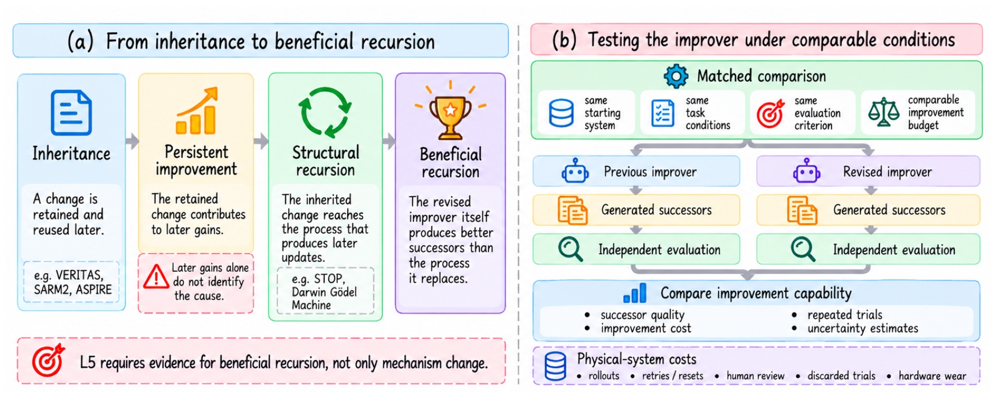
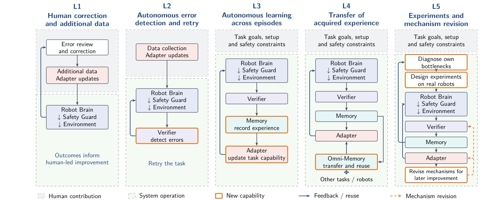
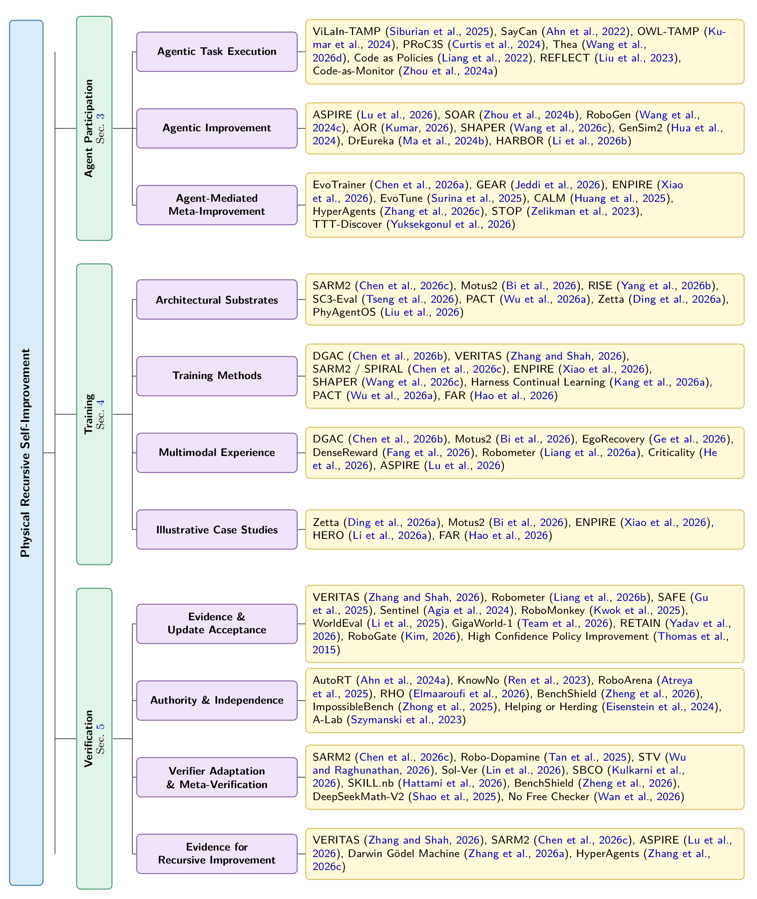

`<a id="readme-top"></a>`

<div align="center">

<h1><em>Physical RSI</em></h1>

<p align="center"><strong>Physical Recursive Self-Improvement</strong></p>

<p align="center"><em>From adaptation to inherited improvement.</em></p>

<p align="center">A paper-aligned, evidence-auditable map of recursive improvement in embodied systems.</p>

<p align="center">
  <a href="#paper-catalog"></a>
  <a href="docs/paper-reference-index.md"></a>
  <a href="#capability-map"></a>
  <a href="LICENSE"></a>
</p>

<p align="center">
  <a href="#the-boundary">Boundary</a>  | 
  <a href="#capability-map">L1-L5</a>  | 
  <a href="#featured-evidence-register">Evidence register</a>  | 
  <a href="#three-views-of-one-system">Research map</a>  | 
  <a href="#paper-catalog">Paper catalog</a>  | 
  <a href="docs/paper-reference-index.md">All references</a>  | 
  <a href="#contributing">Contribute</a>
</p>

</div>

<p align="center">
  
</p>
<p align="center"><em>Life is not repetition, but creation. Duration carries the whole of reality: a boundless river flowing toward a horizon with no predetermined end.</em><br>
<sub>Darwin's <a href="https://commons.wikimedia.org/wiki/File:Darwin_Tree_1837.png">first evolutionary tree</a> (1837), beside Haeckel's <a href="https://commons.wikimedia.org/wiki/File:Pedigree_of_man_(Haeckel_1874).jpg"><em>Pedigree of Man</em></a> (1874). Both works are public domain.</sub></p>

`<a id="from-evolution-to-physical-rsi"></a>`

## From Evolution to Physical RSI `<sub><a href="#readme-top">`top `</a></sub>`

Natural evolution did not become powerful because organisms changed once. Variation mattered
because selection acted on it, and inheritance carried the consequences forward. Across
generations, the environment became part of the history of what life could become.

Physical RSI asks whether an embodied artificial system can form an engineered counterpart to
this chain. Physical interaction supplies experience, verification determines which changes are
admitted, and inheritance returns accepted changes to the next improvement cycle.

> **Can the world change not only what a machine does, but how it produces its next
> improvement?**

The analogy deliberately stops there. Natural selection does not owe us a protected objective,
an audit trail, or a matched resource budget. An engineered recursive system does. A robot may
collect more data, recover from a failed grasp, or fine-tune a policy after deployment, but these
remain forms of adaptation until a retained change reaches the mechanism that generates,
evaluates, or selects later updates. The recursion becomes *physical* only when real interaction
has a causal role in deciding what mechanism changes or survives.

This repository is for **Physical Recursive Self-Improvement** research, where we study how
physical interaction can drive retained changes in embodied systems and the processes that improve
them. It follows the evidence boundaries of the accompanying paper and serves as a reading map,
not a leaderboard: labels such as "self-improving," "autonomous," or "lifelong" are not treated as
evidence on their own.

This repository is actively maintained. If an author would prefer not to have a paper listed here,
please contact <shangding.gu@berkeley.edu>. Constructive comments, corrections, and suggestions are
welcome.

You are also welcome to update the collection. To suggest a missing paper or correct an existing
entry, you can:

- fork this repository and open a pull request;
- [report an issue](https://github.com/SAIL-Research-Lab/Physical-RSI/issues);
- or email <shangding.gu@berkeley.edu>.

**Content**

The repository is organized to be read from definitions and evidence to methods, papers, and
validation:

- [From Evolution to Physical RSI](#from-evolution-to-physical-rsi)
- [The Boundary](#the-boundary)
- [Capability Map](#capability-map)
- [Featured Evidence Register](#featured-evidence-register)
- [Agent Participation, Training, and Verification](#three-views-of-one-system)
- [Paper Catalog](#paper-catalog)
- [Open Questions](#open-questions)
- [Paper Reference Coverage](#paper-reference-coverage)
- [Contributing](#contributing)
- [Data Provenance and Validation](#data-provenance-and-validation)
- [License](#license)

---

`<a id="the-boundary"></a>`

## The Boundary `<sub><a href="#readme-top">`top `</a></sub>`

The relevant "self" is the complete embodied improvement system: policy, safety guard, verifier,
memory, data pipeline, training procedure, and the infrastructure that decides which changes
persist. Deploying a fixed improvement loop on a robot is not enough.

Four claims that are often collapsed should be kept separate:

| Claim                            | What must be shown                                                                                     |
| -------------------------------- | ------------------------------------------------------------------------------------------------------ |
| **Inheritance**            | A change from one cycle is retained and used later.                                                    |
| **Persistent improvement** | The retained change contributes to better later performance.                                           |
| **Structural recursion**   | The retained change modifies the process that produces later updates.                                  |
| **Beneficial recursion**   | Under matched conditions, the revised process produces better successors than the process it replaced. |

<p align="center">
  <a href="docs/figures/beneficial-recursion.jpg"></a>
</p>
<p align="center"><sub><strong>Figure 14.</strong> Beneficial recursion requires testing the improver, not only its latest successor.</sub></p>

Structural recursion establishes the recursive form. Beneficial recursion establishes that the
recursive change actually helped. A persuasive comparison starts from the same system, uses the
same task conditions and protected evaluation criterion, and accounts for robot trials, resets,
hardware wear, compute, search, and human effort.

`<a id="capability-map"></a>`

## Capability Map `<sub><a href="#readme-top">`top `</a></sub>`

L1-L5 are **independent evidence claims**, not a maturity ladder. A workflow may support several
capabilities, and a higher number does not silently establish the levels below it. Classification
applies to the demonstrated workflow, not to the title of a paper.

<p align="center">
  <a href="docs/figures/capability-levels.png"></a>
</p>
<p align="center"><sub><strong>Figure 3.</strong> Five capability categories of physical self-improvement.</sub></p>

| Capability                                              | Deciding question                                                                                                            | Representative evidence                                                                                                                                                                                           |
| ------------------------------------------------------- | ---------------------------------------------------------------------------------------------------------------------------- | ----------------------------------------------------------------------------------------------------------------------------------------------------------------------------------------------------------------- |
| **L1: Human-supported improvement**               | Does a person supply the corrective information that determines what changes?                                                | [ConRFT](https://arxiv.org/abs/2502.05450) learns from robot trajectories containing operator corrections.                                                                                                           |
| **L2: Autonomous error recognition and recovery** | Does the system detect an unsatisfactory execution and choose how to recover?                                                | [DoReMi](https://sites.google.com/view/doremi-paper) detects task-constraint violations and replans; [REFLECT](https://arxiv.org/abs/2306.15724) explains failures and proposes repairs.                                |
| **L3: Autonomous learning across episodes**       | Does physical experience produce a system-directed, retained change used later?                                              | [SELFI](https://proceedings.mlr.press/v270/hirose25a.html) improves navigation through autonomous practice; [VERITAS](https://arxiv.org/abs/2606.18247) returns verified rollouts to policy training.                   |
| **L4: Transfer of acquired experience**           | Is the contribution of prior experience demonstrated in another task, scene, environment, or embodiment?                     | [SOAR](https://arxiv.org/abs/2407.20635) isolates cross-scene experience; [ASPIRE](https://arxiv.org/abs/2607.00272) retrieves discovered skills for real-robot programming.                                            |
| **L5: Physically grounded mechanism improvement** | Does physical evidence revise an inherited improvement mechanism, and does that mechanism produce better later improvements? | [ENPIRE](https://arxiv.org/abs/2606.19980) revises and reuses robot-training code, making it an important **L5 candidate**. It does not yet provide the matched improver comparison required for confirmed L5. |

The paper finds strong evidence for the lower capabilities and early evidence for physically grounded
mechanism revision. It does **not** identify a reviewed physical workflow that conclusively
demonstrates strict, beneficial L5.

`<a id="featured-evidence-register"></a>`

## Featured Evidence Register `<sub><a href="#readme-top">`top `</a></sub>`

This compact register makes the classification decision inspectable. Capability, grounding, and
updated object are recorded independently; the final column states the main evidential limit rather
than repeating the paper's abstract claim.

| Workflow                                                | Capability       | Grounding    | Updated object                | Status and boundary                                                                                                          |
| ------------------------------------------------------- | ---------------- | ------------ | ----------------------------- | ---------------------------------------------------------------------------------------------------------------------------- |
| [ConRFT](https://arxiv.org/abs/2502.05450)                 | `L1`           | `Physical` | Policy, critic, replay data   | **Supported:** operator corrections determine the learning signal.                                                     |
| [DoReMi](https://sites.google.com/view/doremi-paper)       | `L2`           | `Hybrid`   | Plan, failure detector        | **Supported:** recovery is online; detector transfer is offline.                                                       |
| [REFLECT](https://arxiv.org/abs/2306.15724)                | `L2 candidate` | `Physical` | Explanation, repair plan      | **Candidate:** physical failures inform recovery, but the autonomy claim depends on the evaluated setup.               |
| [SELFI](https://proceedings.mlr.press/v270/hirose25a.html) | `L3`           | `Physical` | Policy, critic                | **Supported:** autonomous practice produces retained cross-episode learning.                                           |
| [VERITAS](https://arxiv.org/abs/2606.18247)                | `L3`           | `Physical` | Policy, verified data         | **Supported:** verified real-world rollouts return to policy training.                                                 |
| [RISE](https://arxiv.org/abs/2602.11075)                   | `L3 candidate` | `Hybrid`   | Policy, dynamics, value       | **Candidate:** physical grounding is followed by imagined refinement.                                                  |
| [SOAR](https://arxiv.org/abs/2407.20635)                   | `L3`, `L4`   | `Physical` | Policy, robot data            | **Supported:** persistent learning and cross-scene transfer are evaluated.                                             |
| [Robometer](https://arxiv.org/abs/2603.02115)              | `L4`           | `Physical` | Reward model, target policies | **Supported:** a transferred reward model supplies feedback for target policies.                                       |
| [ASPIRE](https://arxiv.org/abs/2607.00272)                 | `L4`           | `Hybrid`   | Programs, repair skills       | **Supported:** simulation-discovered skills are retrieved for real-robot programs.                                     |
| [ENPIRE](https://arxiv.org/abs/2606.19980)                 | `L5 candidate` | `Physical` | Training code, recipes        | **Candidate:** the mechanism is revised and reused, but beneficial recursion is not isolated under matched conditions. |

The register is intentionally selective. It identifies representative evidence needed to understand
the taxonomy; the [paper catalog](#paper-catalog) provides broader reading coverage, and the
[reference index](docs/paper-reference-index.md) records every unique work cited by the manuscript.

`<a id="three-views-of-one-system"></a>`

## Three Views of One System `<sub><a href="#readme-top">`top `</a></sub>`

Agent participation, training, and verification are complementary views of the same improvement
system. The first asks what an agent's output controls; the second asks how experience becomes a
persistent update; the third asks what the system is allowed to carry forward.

<p align="center">
  <a href="docs/figures/research-landscape.png"></a>
</p>
<p align="center"><sub><strong>Figure 5.</strong> The paper's research landscape and representative systems.</sub></p>

### 1. Agent participation

Agent roles are classified by the later use of their outputs, not by whether those outputs are code,
weights, or text.

| Loop                                     | What the output controls                                                                   | Representative work                                                                                                                                                                       |
| ---------------------------------------- | ------------------------------------------------------------------------------------------ | ----------------------------------------------------------------------------------------------------------------------------------------------------------------------------------------- |
| **Loop 1: Task execution**         | The current task: specification, planning, tool use, execution, or outcome interpretation. | [SayCan](https://arxiv.org/abs/2204.01691), [Code as Policies](https://arxiv.org/abs/2209.07753), [Code-as-Monitor](https://arxiv.org/abs/2412.04455)                                              |
| **Loop 2: Capability improvement** | A harness or model capability used in later tasks.                                         | [SOAR](https://arxiv.org/abs/2407.20635), [RoboGen](https://arxiv.org/abs/2311.01455), [DrEureka](https://arxiv.org/abs/2406.01967), [SHAPER](https://arxiv.org/abs/2608.11350)                       |
| **Loop 3: Meta-improvement**       | The procedure that produces or selects future capability improvements.                     | [ENPIRE](https://arxiv.org/abs/2606.19980), [EvoTrainer](https://arxiv.org/abs/2606.03108), [HyperAgents](https://arxiv.org/abs/2603.19461), [Darwin Godel Machine](https://arxiv.org/abs/2505.22954) |

A reward written for one training run is a Loop 2 input. Changing the procedure that generates or
selects rewards belongs to Loop 3. Digital and simulation studies clarify this boundary, but they do
not become evidence of Physical RSI without physical grounding and inherited use in the same
workflow.

### Harness adaptation update

The [Harness adaptation guide](docs/harness-adaptation.md) expands the agent perspective into
feedback interpretation, memory/skill/workflow changes, adoption and improvement history, and
meta-improvement of the update-generating method. It includes four current chapter figures and
mechanism-level reading tables, with digital and simulation evidence identified separately from
physical evidence.

The [Harness chapter reference supplement](docs/harness-reference-supplement.md) records the
saved chapter's citations as of 11 October 2026. This is an extension to the September manuscript
snapshot, not a revision of its 102-work bibliography count.

### 2. Training

Training is a continuing, gated process rather than a one-off offline stage:

> **experience collection -> evaluation and credit -> parameter update -> verification and consolidation**

#### 1. Data Preparation

Experience generation and selection determine what the learner practices and which trajectories become training data.

##### Task, environment, and practice generation

- **[Self-Improving Robots: End-to-End Autonomous Visuomotor Reinforcement Learning](https://proceedings.mlr.press/v229/sharma23b.html)** (2023) — Autonomous real-world practice connects visuomotor policy learning with reset and training infrastructure.
- **[Find Something You Can&#39;t Do: Agentic Real-World Reinforcement Learning for Self-Improving VLA Models](https://arxiv.org/abs/2609.32069v1)** (2026) — Scene-conditioned, weakness-aware task selection directs real-world practice; residual RL improves a frozen VLA.
- **[GenSim: Generating Robotic Simulation Tasks via Large Language Models](https://arxiv.org/abs/2310.01361)** (2024) — LLMs generate robotic simulation tasks to expand the experience available for policy learning.
- **[GenSim2: Scaling Robot Data Generation with Multi-modal and Reasoning LLMs](https://arxiv.org/abs/2410.03645)** (2024) — Multimodal and reasoning LLMs scale simulated task construction and robot-data generation.
- **[CurricuLLM: Automatic Task Curricula Design for Learning Complex Robot Skills using Large Language Models](https://arxiv.org/abs/2409.18382)** (2024) — LLMs organize task curricula for learning increasingly complex robot skills.
- **[RoboGen: Towards Unleashing Infinite Data for Automated Robot Learning via Generative Simulation](https://arxiv.org/abs/2311.01455)** (2024) — Generative simulation constructs tasks, scenes, rewards, and demonstrations for automated robot learning.
- **[Scaling Sim-to-Real VLA Reinforcement Learning with Generative 3D Worlds](https://arxiv.org/abs/2603.18532)** (2026) — Generative 3D environments broaden simulation coverage for sim-to-real VLA reinforcement learning.
- **[SimWorld Studio: Automatic Environment Generation with Evolving Coding Agent for Embodied Agent Learning](https://arxiv.org/abs/2605.09423)** (2026) — An evolving coding agent generates simulation environments for embodied-agent training.
- **[HomeBody: A Humanoid That Explores, Remembers, and Acts on Its Own](https://tml.stanford.edu/homebody/)** (2026) — Observation- and SLAM-derived digital twins support spatial reasoning and execution; this is an environment-preparation precedent.

##### Experience selection, human guidance, and recovery

- **[MAGMA-GEN: Validated Recovery Supervision from Ambiguous Failures via Counterfactual Re-Execution](https://arxiv.org/abs/2609.20056)** (2026) — Coach-proposed recovery actions undergo matched-state counterfactual re-execution, generating validated supervision from the policy's failed rollouts.
- **[Robot Learning on the Job: Human-in-the-Loop Autonomy and Learning During Deployment](https://arxiv.org/abs/2211.08416)** (2023) — Human interventions and deployment experience support continuing robot-policy learning.
- **[Precise and Dexterous Robotic Manipulation via Human-in-the-Loop Reinforcement Learning](https://arxiv.org/abs/2410.21845)** (2025) — Human-guided real-world RL combines demonstrations, corrections, and online interaction for dexterous manipulation.
- **[ThriftyDAgger: Budget-Aware Novelty and Risk Gating for Interactive Imitation Learning](https://arxiv.org/abs/2109.08273)** (2021) — Novelty and risk gates allocate a limited human-query budget during interactive imitation learning.
- **[Zero2Skill: Bootstrapping Robot Skills through Autonomous Data Collection, Training, and Deployment](https://arxiv.org/abs/2607.14047v3)** (2026) — A collection–training–deployment workflow bootstraps robot skills with human correction memory.
- **[EgoRecovery: Acquiring Failure Recovery Ability Through Human Recovery Demonstration](https://arxiv.org/abs/2607.19745)** (2026) — Human recovery demonstrations supply supervision for learning from failure states.
- **[Autonomous Improvement of Instruction Following Skills via Foundation Models](https://arxiv.org/abs/2407.20635)** (2024) — Foundation-model-guided autonomous collection admits successful robot experience for subsequent policy improvement.
- **[FAR: Failure-Aware Retry for Test-Time Recovery and Continual Policy Improvement](https://arxiv.org/abs/2607.01111)** (2026) — Failure-aware retries recover execution and return successful recovery experience to continual policy training.
- **[Self-Evolving Learning for Embodied AI with Criticality Model](https://arxiv.org/abs/2607.28251)** (2026) — An updated criticality predictor focuses experience collection on failure-prone states.

##### Adaptive simulation distributions and exploration

- **[Closing the Sim-to-Real Loop: Adapting Simulation Randomization with Real World Experience](https://arxiv.org/abs/1810.05687)** (2019) — Real-world experience updates simulation-randomization distributions for later policy training.
- **[Data-Efficient Domain Randomization With Bayesian Optimization](https://doi.org/10.1109/LRA.2021.3052391)** (2021) — Real-world policy returns guide Bayesian optimization of domain-randomization distributions.
- **[Neural Posterior Domain Randomization](https://proceedings.mlr.press/v164/muratore22a.html)** (2022) — Neural posterior inference estimates simulator-parameter distributions from observed experience.
- **[Planning to Explore via Self-Supervised World Models](https://arxiv.org/abs/2005.05960)** (2020) — World-model uncertainty guides exploration and the collection of informative experience.

#### 2. Training Methods

Pretraining establishes behavioral and perceptual priors; imitation, self-supervision, and reinforcement learning incorporate subsequent experience.

##### Overview

- **[Training Methods and Generation Technologies for Embodied Intelligent Robot Manipulation Skill Models: A Systematic Review](https://www.techscience.com/cmc/v89n1/68409)** (2026) — A review of robot manipulation training, skill generation, motion control, and deployment challenges.
- **[Vision-Language-Action Models for Robotics: A Review Towards Real-World Applications](http://dx.doi.org/10.1109/ACCESS.2025.3609980)** (2025) — A review of VLA architectures, training strategies, and challenges in real-world deployment.
- **[World Model for Robot Learning: A Comprehensive Survey](https://arxiv.org/abs/2605.00080)** (2026) — A review of predictive models for policy learning, planning, learned simulation, evaluation, and data generation.
- **[Towards AI That Improves Itself: A Survey of Recursive Self-Improvement](https://lee1003-lee.github.io/Awesome-RSI-Research/assets/rsi-survey.pdf)** (year not specified in PSI.bib) — A general RSI framework covering model/data evolution, retained updates, and improvement of research processes.
- **[Recursive Self-Improvement in AI: A Survey](https://www.preprints.org/manuscript/202609.2680/v1)** (2026, preprint) — A mechanism-oriented review connecting self-training, AutoML, meta-learning, and editable improvement procedures.

##### Imitation learning

- **[ReGuide: From Test-Time Guidance to Self-Improving Diffusion Policies](https://arxiv.org/abs/2606.28939)** (2026) — Successful phase-guided recovery rollouts are reused for iterative diffusion-policy fine-tuning or retraining in simulation.
- **[RoboCat: A Self-Improving Generalist Agent for Robotic Manipulation](https://openreview.net/forum?id=vsDnJ2WR4x)** (2023) — A generalist manipulation model uses demonstrations and self-generated data for later training and adaptation.
- **[What Matters in Learning from Offline Human Demonstrations for Robot Manipulation](https://arxiv.org/abs/2108.03298)** (2021) — Studies dataset and algorithm choices for learning manipulation policies from offline human demonstrations.
- **[OpenVLA: An Open-Source Vision-Language-Action Model](https://arxiv.org/abs/2406.09246)** (2024) — An open VLA supports action-token prediction and parameter-efficient or full model adaptation.
- **[FAST: Efficient Action Tokenization for Vision-Language-Action Models](https://arxiv.org/abs/2501.09747)** (2025) — Compressed action tokens make autoregressive VLA training more efficient.
- **[Diffusion Policy: Visuomotor Policy Learning via Action Diffusion](https://arxiv.org/abs/2303.04137)** (2024) — Action-distribution learning through diffusion supplies a generative behavior-cloning policy.
- **[π₀: A Vision-Language-Action Flow Model for General Robot Control](https://arxiv.org/abs/2410.24164)** (2024 preprint; RSS 2025) — Flow matching learns continuous action chunks on top of pretrained vision-language representations.
- **[One-Step Diffusion Policy: Fast Visuomotor Policies via Diffusion Distillation](https://arxiv.org/abs/2410.21257)** (2024) — Teacher-policy distillation replaces iterative diffusion sampling with a one-step action generator.
- **[Generative Adversarial Imitation Learning](https://arxiv.org/abs/1606.03476)** (2016) — Adversarial distribution matching provides an alternative imitation-learning objective.
- **[One-Shot Imitation from Observing Humans via Domain-Adaptive Meta-Learning](https://arxiv.org/abs/1802.01557)** (2018) — Domain-adaptive meta-learning supplies a precedent for learning an imitation objective from cross-domain demonstrations.

##### Self-supervised learning

- **[Real-World Robot Learning with Masked Visual Pre-training](https://arxiv.org/abs/2210.03109)** (2022) — Masked visual reconstruction provides representations for downstream robot-policy learning.
- **[Latent Action Pretraining from Videos](https://arxiv.org/abs/2410.11758)** (2025) — Latent actions learned from videos reduce dependence on expert action labels during pretraining.
- **[Structured World Models from Human Videos](https://arxiv.org/abs/2308.10901)** (2023) — Human-video predictive priors are adapted with robot experience for world-model-based learning.
- **[DayDreamer: World Models for Physical Robot Learning](https://proceedings.mlr.press/v205/wu23c.html)** (2023) — Real robot trajectories update a world model that supplies imagined experience for policy learning.
- **[VLAW: Iterative Co-Improvement of Vision-Language-Action Policy and World Model](https://arxiv.org/abs/2602.12063)** (2026) — Real rollouts refine a video world model, which generates supplemental data for iterative VLA improvement.
- **[RoboTTT: Context Scaling for Robot Policies](https://arxiv.org/abs/2607.15275)** (2026) — Test-time training scales policy context; fast-weight updates support adaptation during execution.
- **[Automated Self-Supervised Learning for Graphs](https://arxiv.org/abs/2106.05470)** (2022) — Searches combinations and weights of self-supervised objectives for graphs; a digital methodological precedent.

##### Reinforcement learning

- **[Embodied Learning under Policy and Dynamics Shifts](https://doi.org/10.1093/nsr/nwag506)** (2026) — OMPO corrects policy and dynamics shifts when reusing historical replay for continual RL adaptation on control and manipulation benchmarks.
- **[SELFI: Autonomous Self-Improvement with RL for Vision-Based Navigation around People](https://proceedings.mlr.press/v270/hirose25a.html)** (2025) — Autonomous real-world interaction improves vision-based navigation around people.
- **[Lifelong Autonomous Improvement of Navigation Foundation Models in the Wild](https://proceedings.mlr.press/v270/stachowicz25a.html)** (2025) — Deployment experience continually adapts navigation foundation models in real environments.
- **[Continuously Improving Mobile Manipulation with Autonomous Real-World RL](https://proceedings.mlr.press/v270/mendonca25a.html)** (2025) — Autonomous real-world RL supports continuing improvement of mobile-manipulation policies.
- **[Learning While Deploying: Fleet-Scale Reinforcement Learning for Generalist Robot Policies](https://arxiv.org/abs/2605.00416)** (2026) — Fleet-scale deployment experience feeds reinforcement learning of generalist robot policies.
- **[Cal-QL: Calibrated Offline RL Pre-Training for Efficient Online Fine-Tuning](https://arxiv.org/abs/2303.05479)** (2024) — Calibrated offline RL pretraining provides a starting point for efficient online fine-tuning.
- **[ConRFT: A Reinforced Fine-tuning Method for VLA Models via Consistency Policy](https://arxiv.org/abs/2502.05450)** (2025) — Consistency-policy fine-tuning combines prior data, online robot interaction, and human corrections.
- **[π*₀.₆: a VLA That Learns From Experience](https://arxiv.org/abs/2511.14759)** (2025) — RECAP combines demonstrations, deployment rollouts, and expert interventions through advantage-conditioned VLA learning.
- **[Diffusion Policy Policy Optimization](https://arxiv.org/abs/2409.00588)** (2024) — Reinforcement learning fine-tunes diffusion policies through their denoising process.
- **[Steering Your Diffusion Policy with Latent Space Reinforcement Learning](https://arxiv.org/abs/2506.15799)** (2025) — A learned latent-space controller steers a frozen diffusion policy.
- **[EvoHIL: Self-Evolving Reward and Flow-Matched Policy Optimization for Robust Human-in-the-Loop Reinforcement Learning](https://arxiv.org/abs/2608.03872)** (2026) — Human-confirmed outcomes adapt the reward model alongside flow-matched policy optimization.
- **[Efficient Language-instructed Skill Acquisition via Reward-Policy Co-Evolution](https://arxiv.org/abs/2412.13492)** (2024) — Iterative reward-code and policy co-evolution supports language-instructed skill acquisition.
- **[Discovering State-of-the-Art Reinforcement Learning Algorithms](https://doi.org/10.1038/s41586-025-09761-x)** (2025) — Meta-learning discovers policy and prediction update rules on digital RL benchmarks.
- **[Differentiable Evolutionary Reinforcement Learning](https://arxiv.org/abs/2512.13399)** (2026) — Policy-validation performance trains a meta-optimizer that generates future reward structures in digital tasks.

#### 3. Learning Models

The same learning paradigms can update action generation, predictive dynamics, or the signals that guide future learning.

##### Vision-language-action models

- **[SEES: A Self-Evolving Embodied System via Failure-Guided VLA Policy Adaptation](https://arxiv.org/abs/2609.32698)** (2026) — Failure bottlenecks trigger targeted simulation tasks and RL updates to shared VLA adapters, supporting transfer across related skills.
- **[RedFlow: Redirect Failure into Action-level Corrections for Flow-matching VLA Policy](https://arxiv.org/abs/2607.27782)** (2026) — Offline post-training uses fixed rollouts, matched execution contexts, and higher-quality action chunks to derive corrective targets for flow-matching VLAs.
- **[Zeva-Ego: Egocentric Mid-Training with In-Context Causal Learning for Robot Manipulation](https://arxiv.org/abs/2609.24411)** (2026) — Action-centered supervision from egocentric video supports VLA mid-training; deployment-time causal adaptation uses interaction feedback without parameter updates.
- **[RT-2: Vision-Language-Action Models Transfer Web Knowledge to Robotic Control](https://proceedings.mlr.press/v229/zitkovich23a.html)** (2023) — Action-token training transfers web-scale vision-language knowledge into robot control.
- **[Octo: An Open-Source Generalist Robot Policy](https://doi.org/10.15607/RSS.2024.XX.090)** (2024) — A generalist robot policy uses a diffusion action head and supports downstream adaptation.
- **[RDT-1B: a Diffusion Foundation Model for Bimanual Manipulation](https://arxiv.org/abs/2410.07864)** (2025) — A diffusion foundation model supplies continuous action generation for bimanual manipulation.
- **[Knowledge Insulating Vision-Language-Action Models: Train Fast, Run Fast, Generalize Better](https://doi.org/10.52202/085713-3439)** (2025) — Gradient isolation separates discrete-action backbone training from the continuous-action expert.
- **[RT-H: Action Hierarchies using Language](https://doi.org/10.15607/RSS.2024.XX.049)** (2024) — Language-conditioned action hierarchies structure high-level interpretation and low-level control.
- **[Hi Robot: Open-Ended Instruction Following with Hierarchical Vision-Language-Action Models](https://arxiv.org/abs/2502.19417)** (2025) — Hierarchical VLAs coordinate open-ended instruction interpretation with action generation.
- **[GR00T N1: An Open Foundation Model for Generalist Humanoid Robots](https://arxiv.org/abs/2503.14734)** (2025) — An open humanoid foundation model combines high-level vision-language reasoning with action generation.
- **[RL Token: Bootstrapping Online RL with Vision-Language-Action Models](https://arxiv.org/abs/2604.23073)** (2026) — A compact RL-token interface supports online actor–critic learning around a pretrained VLA.

##### World models and world-action models

- **[Self-Improving Robot Policy with Compositional World Model](https://www.roboticsproceedings.org/rss22/p012.html)** (2026) — A compositional world model supports repeated policy optimization through imagined rollouts.
- **[World-VLA-Loop: Closed-Loop Learning of Video World Model and VLA Policy](https://arxiv.org/abs/2602.06508)** (2026) — Improved-policy rollouts refine a video world model used for subsequent VLA post-training.
- **[Learning Universal Policies via Text-Guided Video Generation](https://arxiv.org/abs/2302.00111)** (2023) — Text-guided video generation and inverse dynamics connect predicted outcomes to robot actions.
- **[TD-MPC2: Scalable, Robust World Models for Continuous Control](https://arxiv.org/abs/2310.16828)** (2024) — Latent world-model learning supports scalable planning and continuous control.
- **[WorldEval: World Model as Real-World Robot Policies Evaluator](https://arxiv.org/abs/2505.19017)** (2025) — A world model predicts policy outcomes for evaluation; its role differs from direct policy training.
- **[Learning Interactive Real-World Simulators](https://arxiv.org/abs/2310.06114)** (2024) — An interactive generative simulator supplies synthetic experience for policy learning.
- **[Ctrl-World: A Controllable Generative World Model for Robot Manipulation](https://arxiv.org/abs/2510.10125)** (2026) — Action-conditioned, multi-view predictions support policy ranking and synthetic-data fine-tuning.
- **[Motus2: A Self-Evolving General World Model for Dexterous Manipulation](https://arxiv.org/abs/2608.30237)** (2026) — Shared weights expose policy, simulator, and evaluator interfaces in a unified decision-and-learning loop.
- **[WAM-RL: World-Action Model Reinforcement Learning with Reconstruction Rewards and Online Video SFT](https://arxiv.org/abs/2606.17906)** (2026) — World-action-model RL combines reconstruction rewards with online video supervised fine-tuning.

##### Reward models and value learning

- **[LIV: Language-Image Representations and Rewards for Robotic Control](https://arxiv.org/abs/2306.00958)** (2023) — Language-image representations provide task-progress and reward signals for robotic control.
- **[RoboReward: General-Purpose Vision-Language Reward Models for Robotics](https://arxiv.org/abs/2601.00675)** (2026) — General-purpose vision-language reward modeling supplies task-outcome feedback.
- **[Robometer: Scaling General-Purpose Robotic Reward Models via Trajectory Comparisons](https://arxiv.org/abs/2603.02115)** (2026) — Trajectory comparisons train a general-purpose robotic reward model.
- **[SARM2: Multi-Task Stage Aware Reward Modeling for Self Improving Robotic Manipulation](https://arxiv.org/abs/2606.10305)** (2026) — Stage estimation and value learning provide dense rewards for subsequent VLA policy improvement.
- **[DenseReward: Dense Reward Learning via Failure Synthesis for Robotic Manipulation](https://arxiv.org/abs/2607.13033)** (2026) — Synthesized failure examples support dense reward learning for manipulation.
- **[Robo-Dopamine: General Process Reward Modeling for High-Precision Robotic Manipulation](https://arxiv.org/abs/2512.23703)** (2025) — Process reward modeling supplies fine-grained feedback for high-precision manipulation.
- **[PEBBLE: Feedback-Efficient Interactive Reinforcement Learning via Relabeling Experience and Unsupervised Pre-training](https://arxiv.org/abs/2106.05091)** (2021) — Preference-based reward updates alternate with policy learning and replay-experience relabeling.
- **[Flora: Sample-Efficient Preference-Based Rl Via Low-Rank Style Adaptation of Reward Functions](https://doi.org/10.1109/ICRA55743.2025.11127633)** (2025) — Low-rank reward adaptation incorporates new preferences while limiting interference with prior reward knowledge.
- **[Beyond Imitation: Self-Improving Robot Policies via Off-Policy Q-Planning](https://arxiv.org/abs/2608.21204)** (2026) — Successful and failed rollouts update a Q-function for action selection while behavior-cloning weights remain frozen.

#### 4. Knowledge Transfer and Training Procedure Improvement

Transfer retains useful capabilities across tasks; procedure improvement changes how later data or model updates are produced.

##### Cross-task transfer and retention

- **[SRSA: Skill Retrieval and Adaptation for Robotic Assembly Tasks](https://arxiv.org/abs/2503.04538)** (2025) — Retrieved source policies initialize and accelerate learning for new assembly tasks.
- **[EXTRACT: Efficient Policy Learning by Extracting Transferable Robot Skills from Offline Data](https://proceedings.mlr.press/v270/zhang25c.html)** (2025) — Offline robot experience yields transferable skills for efficient downstream policy learning.
- **[PRISE: LLM-Style Sequence Compression for Learning Temporal Action Abstractions in Control](https://arxiv.org/abs/2402.10450)** (2024) — Sequence compression learns reusable temporal action abstractions.
- **[LOTUS: Continual Imitation Learning for Robot Manipulation Through Unsupervised Skill Discovery](https://arxiv.org/abs/2311.02058)** (2024) — Unsupervised skill discovery and skill selection support continual imitation learning.
- **[Sparse Diffusion Policy: A Sparse, Reusable, and Flexible Policy for Robot Learning](https://arxiv.org/abs/2407.01531)** (2024) — Sparse policy modules support reuse and flexible adaptation across robot tasks.
- **[Knowledge Diversion for Efficient Morphology Control and Policy Transfer](https://arxiv.org/abs/2512.09796)** (2025) — Shared and task-specific controller components support efficient transfer across morphologies and tasks.
- **[Towards Human-like Physical Intelligence: Lifelong Vision-Language-Action Learning for Robotic Manipulation](https://arxiv.org/abs/2607.14852)** (2026) — Lifelong VLA learning studies the incorporation of new manipulation capabilities while retaining earlier knowledge.
- **[Robust Finetuning of Vision-Language-Action Robot Policies via Parameter Merging](https://arxiv.org/abs/2512.08333)** (2026) — Parameter merging balances new-task fine-tuning with retention of pretrained VLA behavior.
- **[Pretrained Vision-Language-Action Models are Surprisingly Resistant to Forgetting in Continual Learning](https://arxiv.org/abs/2603.03818)** (2026) — Examines resistance to forgetting during continual adaptation of pretrained VLAs.
- **[Can Vision-Language-Action Models Learn from Real-World Data Continually without Forgetting?](https://arxiv.org/abs/2605.26820)** (2026) — Studies continual real-world VLA learning and preservation of previously learned capabilities.

##### Data-preparation improvement

- **[RoboCoach: World Models as Active Coaches for Compositional Robot Skills](https://arxiv.org/abs/2609.39685)** (2026) — Imagined subtask failures guide demonstration requests and selective expert-adapter updates under matched data budgets.
- **[Curating Demonstrations using Online Experience](https://arxiv.org/abs/2503.03707)** (2025) — Online policy experience helps score and curate demonstrations for later learning.
- **[CUPID: Curating Data your Robot Loves with Influence Functions](https://arxiv.org/abs/2506.19121)** (2025) — Influence functions estimate which robot demonstrations are useful for the learner.
- **[DataMIL: Selecting Data for Robot Imitation Learning with Datamodels](https://arxiv.org/abs/2505.09603)** (2026) — Datamodels select prior data by predicted downstream-policy benefit rather than visual similarity alone.
- **[Re-Mix: Optimizing Data Mixtures for Large Scale Imitation Learning](https://arxiv.org/abs/2408.14037)** (2024) — Learner-dependent mixture optimization adjusts how multiple data sources contribute to imitation learning.
- **[RSIBench-Data: Benchmarking Data-Centric Research for Recursive Self-Improvement](https://arxiv.org/abs/2607.25886)** (2026) — A digital benchmark tests feedback-driven revision of training-data strategies under a fixed post-training stack.

##### Training-method and workflow improvement

- **[Eureka: Human-Level Reward Design via Coding Large Language Models](https://arxiv.org/abs/2310.12931)** (2024) — LLMs revise reward code using training feedback; reward-design search is distinct from changing the search procedure.
- **[EvoTrainer: Co-Evolving LLM Policies and Training Harnesses for Autonomous Agentic Reinforcement Learning](https://arxiv.org/abs/2606.03108)** (2026) — Digital-task feedback co-evolves LLM policies, diagnostics, and retained training-harness strategies.
- **[ENPIRE: Agentic Robot Policy Self-Improvement in the Real World](https://arxiv.org/abs/2606.19980)** (2026) — Real-robot rollouts guide retained revisions to training infrastructure, algorithm code, and recipes.
- **[HARBOR: A Harness Framework for Agentic Robot Reinforcement Learning](https://arxiv.org/abs/2606.08610)** (2026) — Agents automate simulation RL through gated stages, reusable artifacts, and experience from earlier training runs.

### 3. Verification

Verification enters the loop at three different points:

1. **Behavior verification:** should the current action or trajectory continue?
2. **Data admission:** should this experience enter memory or training?
3. **Update release:** should the resulting change become part of the persistent system?

A trajectory score is not an update-release test. Release may also require retention tests,
out-of-distribution evaluation, safety checks, and evidence that old capabilities have not regressed.
[Robometer](https://arxiv.org/abs/2603.02115), [WorldEval](https://arxiv.org/abs/2505.19017),
[RoboArena](https://arxiv.org/abs/2506.18123), and [SC3-Eval](https://arxiv.org/abs/2606.18610)
cover different parts of this problem.

Two forms of independence matter. **Control independence** prevents a candidate from choosing,
modifying, or bypassing its evaluator. **Information independence** prevents repeated feedback from
turning a protected criterion into another optimization target. More judges do not create independent
evidence when they share the same blind spot.

`<a id="paper-catalog"></a>`

## Paper Catalog `<sub><a href="#readme-top">`top `</a></sub>`

The list below follows the compact citation style used by research-map repositories: linked title,
authors, and year. Papers are grouped by their primary role in the Physical RSI argument; some
support more than one perspective. Within each group, papers are ordered newest first; entries from
the same year follow reverse arXiv chronology where available. See the [complete paper reference index](docs/paper-reference-index.md)
for all 102 unique works cited in the manuscript.

### Physical improvement and capability evidence

- [ASPIRE: Agentic Skills Discovery for Robotics](https://arxiv.org/abs/2607.00272) by Runyu Lu et al. 2026.
- [ENPIRE: Agentic Robot Policy Self-Improvement in the Real World](https://arxiv.org/abs/2606.19980) by Wenli Xiao et al. 2026.
- [Visual Verification Enables Inference-Time Steering and Autonomous Policy Improvement](https://arxiv.org/abs/2606.18247) by Mingtong Zhang and Dhruv Shah. 2026.
- [ConRFT: A Reinforced Fine-Tuning Method for VLA Models via Consistency Policy](https://arxiv.org/abs/2502.05450) by Yuhui Chen et al. 2025.
- [SELFI: Autonomous Self-Improvement with RL for Vision-Based Navigation Around People](https://proceedings.mlr.press/v270/hirose25a.html) by Noriaki Hirose et al. 2025.
- [Autonomous Improvement of Instruction Following Skills via Foundation Models](https://arxiv.org/abs/2407.20635) by Zhiyuan Zhou et al. 2024.
- [RoboCat: A Self-Improving Generalist Agent for Robotic Manipulation](https://openreview.net/forum?id=vsDnJ2WR4x) by Konstantinos Bousmalis et al. 2024.
- [DoReMi: Grounding Language Model by Detecting and Recovering from Plan-Execution Misalignment](https://sites.google.com/view/doremi-paper) by Yanjiang Guo et al. 2024.
- [REFLECT: Summarizing Robot Experiences for Failure Explanation and Correction](https://arxiv.org/abs/2306.15724) by Zeyi Liu, Arpit Bahety, and Shuran Song. 2023.
- [Self-Improving Robots: End-to-End Autonomous Visuomotor Reinforcement Learning](https://proceedings.mlr.press/v229/sharma23b.html) by Archit Sharma et al. 2023.

### Agent participation and harnesses

For the updated mechanism-based collection, see [Harness adaptation](docs/harness-adaptation.md)
and its [chapter reference supplement](docs/harness-reference-supplement.md).

- [Self-Evolving Embodied Agents via Skill-Harness Evolution](https://arxiv.org/abs/2608.11350) by Peidong Wang et al. 2026.
- [HARBOR: A Harness Framework for Agentic Robot Reinforcement Learning](https://arxiv.org/abs/2606.08610) by Zechu Li et al. 2026.
- [Grounded Vision-Language Interpreter for Long-Horizon Bimanual Task and Motion Planning](https://arxiv.org/abs/2506.03270) by Jeremy Siburian et al. 2025.
- [Code-as-Monitor: Constraint-Aware Visual Programming for Reactive and Proactive Robotic Failure Detection](https://arxiv.org/abs/2412.04455) by Enshen Zhou et al. 2024.
- [Open-World Task and Motion Planning via Vision-Language Model Generated Constraints](https://arxiv.org/abs/2411.08253) by Nishanth Kumar et al. 2024.
- [GenSim2: Scaling Robot Data Generation with Multi-Modal and Reasoning LLMs](https://arxiv.org/abs/2410.03645) by Pu Hua et al. 2024.
- [Trust the PRoC3S: Solving Long-Horizon Robotics Problems with LLMs and Constraint Satisfaction](https://arxiv.org/abs/2406.05572) by Aidan Curtis et al. 2024.
- [DrEureka: Language Model Guided Sim-to-Real Transfer](https://arxiv.org/abs/2406.01967) by Yecheng Jason Ma et al. 2024.
- [RoboGen: Towards Unleashing Infinite Data for Automated Robot Learning via Generative Simulation](https://arxiv.org/abs/2311.01455) by Yufei Wang et al. 2024.
- [Eureka: Human-Level Reward Design via Coding Large Language Models](https://arxiv.org/abs/2310.12931) by Yecheng Jason Ma et al. 2024.
- [Code as Policies: Language Model Programs for Embodied Control](https://arxiv.org/abs/2209.07753) by Jacky Liang et al. 2022.
- [Do As I Can, Not As I Say: Grounding Language in Robotic Affordances](https://arxiv.org/abs/2204.01691) by Michael Ahn et al. 2022.

### Training, data, and world models

- [Motus2: A Self-Evolving General World Model for Dexterous Manipulation](https://arxiv.org/abs/2608.30237) by Hongzhe Bi et al. 2026.
- [Zetta: An Efficient Closed-Loop Embodied Harness for Self-Evolving Physical Intelligence](https://arxiv.org/abs/2608.16590) by Xin Ding et al. 2026.
- [Evolve Vision-Language-Action Model into an Agent with On-the-Fly Tool Use](https://arxiv.org/abs/2608.14047) by Yi Ding et al. 2026.
- [Self-Evolving Learning for Embodied AI with Criticality Model](https://arxiv.org/abs/2607.28251) by Linxuan He et al. 2026.
- [Practice Makes Policies: Bootstrapping and Consolidating Robotic Capabilities from Zero Human Demonstrations](https://arxiv.org/abs/2607.26809) by Jialiang Li et al. 2026.
- [DenseReward: Dense Reward Learning via Failure Synthesis for Robotic Manipulation](https://arxiv.org/abs/2607.13033) by Yu Fang et al. 2026.
- [FAR: Failure-Aware Retry for Test-Time Recovery and Continual Policy Improvement](https://arxiv.org/abs/2607.01111) by Haoran Hao et al. 2026.
- [Robot Self-Improvement via Human-Video Dynamics Models](https://arxiv.org/abs/2606.21406) by Hanzhi Chen et al. 2026.
- [SARM2: Multi-Task Stage Aware Reward Modeling for Self Improving Robotic Manipulation](https://arxiv.org/abs/2606.10305) by Qianzhong Chen et al. 2026.
- [PACT: Self-Evolving Physical Safety Alignment for Diffusion Policies in Embodied Manipulation](https://arxiv.org/abs/2606.08414) by Lingxuan Wu et al. 2026.
- [RISE: Self-Improving Robot Policy with Compositional World Model](https://arxiv.org/abs/2602.11075) by Jiazhi Yang et al. 2026.
- [Open X-Embodiment: Robotic Learning Datasets and RT-X Models](https://arxiv.org/abs/2310.08864) by the Open X-Embodiment Collaboration. 2024.

### Verification, evaluation, and safety

- [BenchShield: Formal Model-Backed Instrumentation for Reward Integrity in LLM-Agent Evaluation Infrastructure](https://arxiv.org/abs/2609.11028) by Shenghan Zheng et al. 2026.
- [No Free Checker: A Survey of Verifiers for Robot Policies](https://arxiv.org/abs/2609.09250) by Yang Wan et al. 2026.
- [GigaWorld-1: A Roadmap to Build World Models for Robot Policy Evaluation](https://arxiv.org/abs/2607.02642) by the GigaWorld Team. 2026.
- [VLA-FAIL: Efficient Task Failure Detection for Finetuned Vision-Language-Action Models](https://arxiv.org/abs/2606.21386) by Florian Seligmann et al. 2026.
- [SC3-Eval: Evaluating Robot Foundation Models via Self-Consistent Video Generation](https://arxiv.org/abs/2606.18610) by Wei-Cheng Tseng et al. 2026.
- [RoboLab: A High-Fidelity Simulation Benchmark for Analysis of Task Generalist Policies](https://arxiv.org/abs/2604.09860) by Jenai Xuning Yang et al. 2026.
- [ROBOGATE: Adaptive Failure Discovery for Safe Robot Policy Deployment via Two-Stage Boundary-Focused Sampling](https://arxiv.org/abs/2603.22126) by Azuki Kim. 2026.
- [Robometer: Scaling General-Purpose Robotic Reward Models via Trajectory Comparisons](https://arxiv.org/abs/2603.02115) by Anthony Liang et al. 2026.
- [Robust Finetuning of Vision-Language-Action Robot Policies via Parameter Merging](https://arxiv.org/abs/2512.08333) by Yajat Yadav et al. 2026.
- [RoVer: Robot Reward Model as Test-Time Verifier for Vision-Language-Action Model](https://arxiv.org/abs/2510.10975) by Mingtong Dai et al. 2025.
- [RoboArena: Distributed Real-World Evaluation of Generalist Robot Policies](https://arxiv.org/abs/2506.18123) by Pranav Atreya et al. 2025.
- [RoboMonkey: Scaling Test-Time Sampling and Verification for Vision-Language-Action Models](https://arxiv.org/abs/2506.17811) by Jacky Kwok et al. 2025.
- [SAFE: Multitask Failure Detection for Vision-Language-Action Models](https://arxiv.org/abs/2506.09937) by Qiao Gu et al. 2025.
- [WorldEval: World Model as Real-World Robot Policies Evaluator](https://arxiv.org/abs/2505.19017) by Yaxuan Li et al. 2025.
- [Unpacking Failure Modes of Generative Policies: Runtime Monitoring of Consistency and Progress](https://arxiv.org/abs/2410.04640) by Christopher Agia et al. 2024.

### Recursive and meta-improvement

The [Harness meta-improvement guide](docs/harness-adaptation.md#4-meta-improvement-of-adaptation)
connects editable adaptation methods to downstream evaluation and inheritance.

- [AI4AI-Bench: Benchmarking LLM Agents in Algorithmic Design for Recursive Self-Improvement](https://arxiv.org/abs/2608.20318) by Yizhe Chi et al. 2026.
- [SBCO: Self-Supervised, Verifier-Grounded Harness Optimization for Planning Agents](https://arxiv.org/abs/2608.10157) by Vivek Kulkarni et al. 2026.
- [PAST-Bench: Benchmarking the Foundations of Recursive Self-Improvement in Personal Agents](https://arxiv.org/abs/2608.04003) by Shuhan Xue et al. 2026.
- [EvoTrainer: Co-Evolving LLM Policies and Training Harnesses for Autonomous Agentic Reinforcement Learning](https://arxiv.org/abs/2606.03108) by Guhong Chen et al. 2026.
- [Self-Trained Verification for Training- and Test-Time Self-Improvement](https://arxiv.org/abs/2605.30290) by Chen Henry Wu and Aditi Raghunathan. 2026.
- [GEAR: Genetic AutoResearch for Agentic Code Evolution](https://arxiv.org/abs/2605.13874) by Ahmadreza Jeddi et al. 2026.
- [HyperAgents](https://arxiv.org/abs/2603.19461) by Jenny Zhang et al. 2026.
- [Learning to Discover at Test Time](https://arxiv.org/abs/2601.16175) by Mert Yuksekgonul et al. 2026.
- [Darwin Godel Machine: Open-Ended Evolution of Self-Improving Agents](https://arxiv.org/abs/2505.22954) by Jenny Zhang et al. 2026.
- [CALM: Co-Evolution of Algorithms and Language Model for Automatic Heuristic Design](https://arxiv.org/abs/2505.12285) by Ziyao Huang et al. 2025.
- [Algorithm Discovery with LLMs: Evolutionary Search Meets Reinforcement Learning](https://arxiv.org/abs/2504.05108) by Anja Surina et al. 2025.
- [Godel Agent: A Self-Referential Agent Framework for Recursively Self-Improvement](https://aclanthology.org/2025.acl-long.1354/) by Xunjian Yin et al. 2025.
- [Self-Taught Evaluators](https://arxiv.org/abs/2408.02666) by Tianlu Wang et al. 2024.
- [Meta-Rewarding Language Models: Self-Improving Alignment with LLM-as-a-Meta-Judge](https://arxiv.org/abs/2407.19594) by Tianhao Wu et al. 2024.
- [Self-Taught Optimizer: Recursively Self-Improving Code Generation](https://arxiv.org/abs/2310.02304) by Eric Zelikman et al. 2023.
- [Godel Machines: Fully Self-Referential Optimal Universal Self-Improvers](https://doi.org/10.1007/978-3-540-68677-4_7) by Jurgen Schmidhuber. 2007.

`<a id="open-questions"></a>`

## Open Questions `<sub><a href="#readme-top">`top `</a></sub>`

- **Weight-level self-modification:** no physical system has demonstrated a complete, sustained loop in which its own weight-update process improves and continues to benefit.
- **Judge reliability:** verifier and reward-model errors propagate through the training loop.
- **Imagination-reality gap:** world-model error limits imagined training and evaluation.
- **Forgetting and stability:** new policies, values, and world models can erase earlier competence.
- **Sustained safety:** a continuously changing policy needs more than a one-time safety check.
- **Longitudinal evaluation:** repeated self-evaluation needs protected tests and explicit anti-leakage rules.
- **Transfer of training methods:** transferring a skill is not the same as transferring the procedure that learns it.
- **Theory of recursive training:** we lack conditions for convergence when policy, world model, and evaluator train one another.

`<a id="paper-reference-coverage"></a>`

## Paper Reference Coverage `<sub><a href="#readme-top">`top `</a></sub>`

The supplied paper contains **105 bibliography records**. AutoRT, Robometer, and Darwin Godel
Machine each appear twice as preprint and publication records. After consolidating those three
pairs, the repository indexes **all 102 unique works**:

> [Browse the complete Physical RSI paper reference index](docs/paper-reference-index.md)

The full index is separate from the conceptual map on this page so that completeness does not bury
the paper's argument. Inclusion in the bibliography does not imply that a work demonstrates
Physical RSI; the L1-L5 evidence standard still applies.

`<a id="contributing"></a>`

## Contributing `<sub><a href="#readme-top">`top `</a></sub>`

For a new paper, include its canonical title, primary link, year, the object that changes, the
physical evidence used, whether the change persists, and the comparison that supports the claimed
capability. Use this reviewable entry format:

```markdown
1. **Paper Title**
   [[Paper](https://arxiv.org/abs/YYMM.NNNNN)] | arXiv:YYMM.NNNNN
   `Capability-L3` `Grounding-Physical` `Target-Policy`
   *Evidence:* physical outcome -> admitted experience -> persistent update -> later-round effect
   *Boundary:* verifier and training procedure remain fixed
```

Simulation-only and digital RSI work are welcome when their scope is stated explicitly. A title or
abstract using "self-improving" is not enough: the entry must identify where the loop closes and
what is inherited.

Please open an issue or pull request for additions and corrections. The repository is intentionally
lightweight: the README carries the conceptual map, and the paper index carries bibliographic
coverage.

`<a id="data-provenance-and-validation"></a>`

## Data Provenance and Validation `<sub><a href="#readme-top">`top `</a></sub>`

This repository was checked against the supplied 37-page manuscript rather than assembled from
search results alone.

| Check                       | Result                                                                                                                                         |
| --------------------------- | ---------------------------------------------------------------------------------------------------------------------------------------------- |
| Source snapshot             | `IEEE_TPAMI__Physical_RSI-2.pdf`                                                                                                             |
| Source SHA-256              | `dcb0083e70ad39183935074d5a41e26c03539c6779032c5557b8d6699f43e4a8`                                                                           |
| Bibliography reconciliation | 105 records -> 102 unique works                                                                                                                |
| Consolidated versions       | AutoRT, Robometer, and Darwin Godel Machine                                                                                                    |
| arXiv coverage              | 87 identifiers parsed from the manuscript; all 87 occur in the full index                                                                      |
| Featured-to-index check     | 65 README entries; all map to the 102-work index                                                                                               |
| Figure provenance           | Figures 3, 5, and 14 extracted from the supplied manuscript                                                                                    |
| Repository policy           | The source PDF is excluded by `.gitignore`; the original manuscript figures and explicitly documented chapter-update renderings are tracked. |
| Last audit                  | 2026-09-30                                                                                                                                     |

Counts describe this manuscript snapshot. Future additions to the living catalog should be labeled
as repository extensions rather than silently included in the paper's bibliography count.

`<a id="license"></a>`

## License `<sub><a href="#readme-top">`top `</a></sub>`

This repository is released under the [MIT License](LICENSE).
