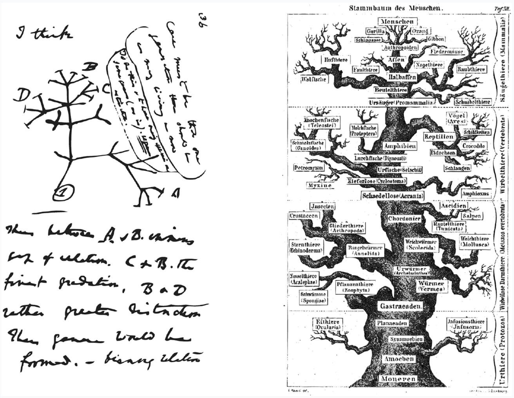
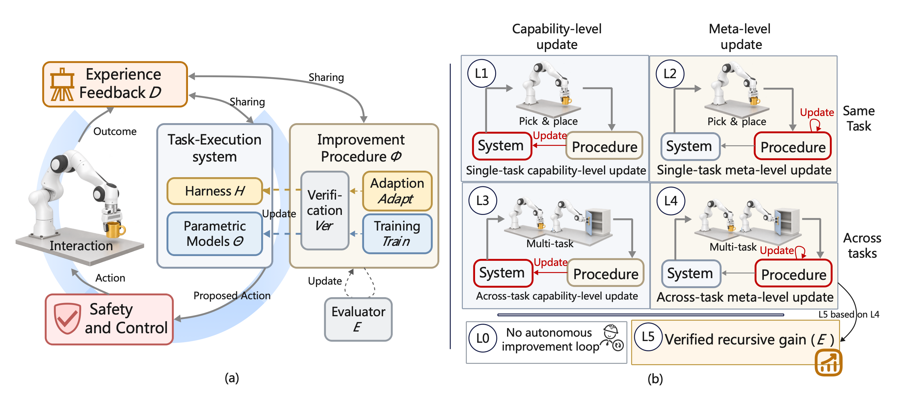
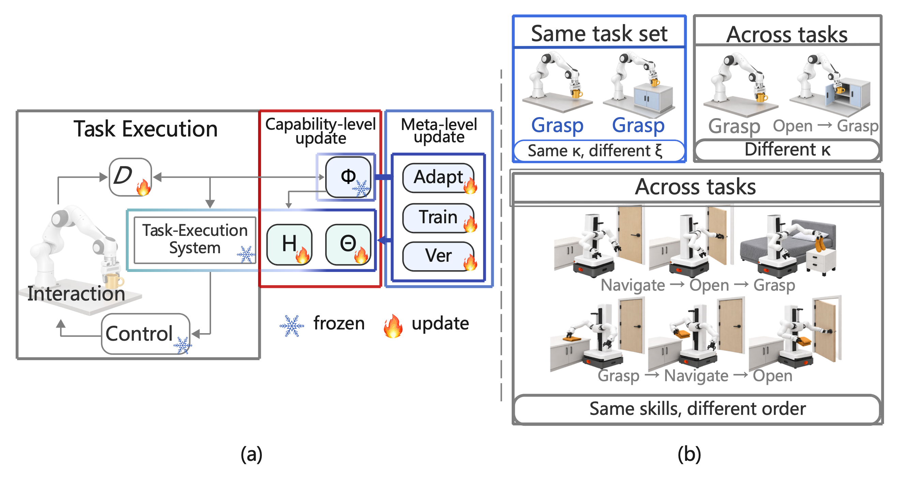
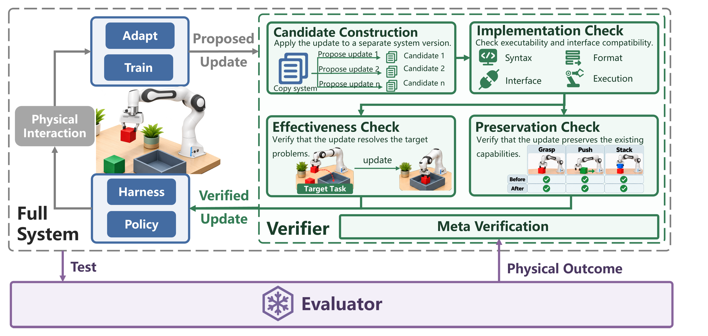

<h1><em>Physical RSI</em></h1>

<strong>Physical Recursive Self-Improvement</strong>

<em>From adaptation to inherited improvement.</em>

A paper-aligned, evidence-auditable map of recursive improvement in embodied systems.

  
  
  

  <a href="#the-boundary">Boundary</a> &nbsp;|&nbsp;
  <a href="#capability-map">L1-L5</a> &nbsp;|&nbsp;
  <a href="#three-views-of-one-system">Research map</a> &nbsp;|&nbsp;
  <a href="#paper-catalog">Paper catalog</a>

  

<em>Life is not repetition, but creation. Duration carries the whole of reality: a boundless river flowing toward a horizon with no predetermined end.</em> 
Darwin's <a href="https://commons.wikimedia.org/wiki/File:Darwin_Tree_1837.png">first evolutionary tree</a> (1837), beside Haeckel's <a href="https://commons.wikimedia.org/wiki/File:Pedigree_of_man_(Haeckel_1874).jpg"><em>Pedigree of Man</em></a> (1874). Both works are public domain.

## From Evolution to Physical RSI <a href="#readme-top">top</a>

Natural evolution did not become powerful because organisms changed once. Variation mattered
because selection acted on it, and inheritance carried the consequences forward. Across
generations, the environment became part of the history of what life could become.

Physical RSI asks whether an embodied artificial system can form an engineered counterpart to
this chain. Physical interaction supplies experience, verification determines which changes are
admitted, and inheritance returns accepted changes to the next improvement cycle.

> **Can the world change not only what a machine does, but how it produces its next
> improvement?**

The analogy deliberately stops there. Natural selection does not owe us a protected objective,
an audit trail, or a matched resource budget. An engineered recursive system does. A robot may
collect more data, recover from a failed grasp, or fine-tune a policy after deployment, but these
remain forms of adaptation until a retained change reaches the mechanism that generates,
evaluates, or selects later updates. The recursion becomes *physical* only when real interaction
has a causal role in deciding what mechanism changes or survives.

This repository is for **Physical Recursive Self-Improvement** research, where we study how
physical interaction can drive retained changes in embodied systems and the processes that improve
them. It follows the evidence boundaries of the accompanying paper and serves as a reading map,
not a leaderboard: labels such as "self-improving," "autonomous," or "lifelong" are not treated as
evidence on their own.

This repository is actively maintained. If an author would prefer not to have a paper listed here,
please contact <shangding.gu@berkeley.edu>. Constructive comments, corrections, and suggestions are
welcome.

You are also welcome to update the collection. To suggest a missing paper or correct an existing
entry, you can:

- fork this repository and open a pull request;
- [report an issue](https://github.com/SAIL-Research-Lab/Physical-RSI/issues);
- or email <shangding.gu@berkeley.edu>.

**Content**

Explore the framework, paper collection, and open questions:

- [From Evolution to Physical RSI](#from-evolution-to-physical-rsi)
- [The Boundary](#the-boundary)
- [Capability Map](#capability-map)
- [Harness Adaptation, Training, and Verification](#three-views-of-one-system)
- [Paper Catalog](#paper-catalog)
- [Open Questions](#open-questions)
- [License](#license)

---

## The Boundary <a href="#readme-top">top</a>

Physical RSI distinguishes the **execution system `M = (Θ, H)`**—models and their harness—from
its **improvement procedure `Φ = (Adapt, Train, Ver)`**. Improving task performance is not the
same as improving the procedure that produces future updates.

  

Task execution, the improvement procedure, safety and control, and the L0–L5 framework.

## Capability Map <a href="#readme-top">top</a>

The framework separates **what changes** from **where the retained gain transfers**:

- **L0:** no autonomous retained-improvement loop.
- **L1 / L3:** inherited execution-system updates improve the same task / transfer across tasks.
- **L2 / L4:** inherited improvement-procedure updates support same-task / cross-task improvement.
- **L5:** successive procedure revisions produce better subsequent improvements under matched
  budgets and protected cross-task evaluation—not merely a changed procedure.

  

Update targets and task identity: a new scene alone does not establish a new task.

## Harness Adaptation, Training, and Verification <a href="#readme-top">top</a>

- **Harness adaptation:** use execution feedback and improvement history to update memory, skills, tools, and workflows, retaining adopted changes for later execution.
- **Model training:** collect and select experience, evaluate outcomes and assign credit,
  update model parameters, then verify and consolidate accepted changes.
- **Safety and control:** constrain trials and reassess safeguards as the system changes.
- **Verification and evaluation:** decide which changes may be retained, then independently
  measure their later benefit.
- **Benchmarks:** assess task performance, robustness, feedback reliability, and development
  processes.

<!-- 

  

Candidate construction, implementation, effectiveness, and preservation checks, with independent evaluation and meta-verification.
 -->

## Paper Catalog <a href="#readme-top">top</a>

<strong>Browse by topic</strong>

- [Foundations and Surveys](#catalog-foundations)
  - [Self-Modifying Systems and Recursive Improvement](#foundations-recursive-systems)
  - [RSI and AutoML Foundations and Surveys](#foundations-surveys)
- [Agent Harnesses and Execution](#catalog-agent-harnesses)
  - [Memory and Knowledge Management](#harness-memory)
  - [Skill Libraries and Tool Construction](#harness-skills)
  - [Planning and Workflows](#harness-workflows)
  - [Failure Diagnosis and Execution Recovery](#harness-recovery)
- [Model Training and Adaptation](#catalog-model-training)
  - [Data Preparation and Generation](#training-data)
  - [Imitation Learning and Generalist Policies](#training-imitation)
  - [Reinforcement Learning and Autonomous Practice](#training-rl)
  - [Self-Supervised and Representation Learning](#training-representations)
  - [Continual Adaptation and Knowledge Transfer](#training-transfer)
  - [Training Procedures and Algorithm Optimization](#training-procedures)
  - [Robot Learning Surveys and Foundations](#training-foundations)
- [Safety and Assurance](#catalog-safety)
  - [Safe Exploration and Constrained Learning](#safety-learning)
  - [Safe Transfer and Update Acceptance](#safety-transfer)
  - [Runtime Control and Failure Monitoring](#safety-runtime)
  - [Oversight and Integrity Protection](#safety-oversight)
  - [Safety Surveys and Risk Taxonomies](#safety-foundations)
- [Verification and Evaluation Methods](#catalog-verification)
  - [Verification of Candidate Updates](#verification-robot-policies)
  - [Verifier Reliability and Meta-Verification](#verification-learned-evaluators)
  - [Evaluation of Improvement Outcomes](#verification-protocols)
- [Benchmarks, Datasets, and Platforms](#catalog-benchmarks)
  - [Shared Robot Datasets](#benchmarks-datasets)
  - [Task Learning, Performance, and Generalization](#benchmarks-tasks)
  - [Robustness and Physical-World Evaluation](#benchmarks-robustness)
  - [Feedback and Evaluation Reliability](#benchmarks-feedback)
  - [Robot Engineering and Development](#benchmarks-engineering)
  - [Research Agent and Self-Improvement Benchmarks](#benchmarks-research-agents)

### Foundations and Surveys

#### Self-Modifying Systems and Recursive Improvement

- [Hyperagents](https://arxiv.org/html/2603.19461v1) by Jenny Zhang et al. 2026.
- [SelfSearch: Reward-Free Search for Self-Improving Agents](https://arxiv.org/html/2609.37968v2) by Jungwoo Yang et al. 2026.
- [Darwin Gödel Machine: Open-Ended Evolution of Self-Improving Agents](https://arxiv.org/abs/2505.22954) by Jenny Zhang et al. 2026.
- [Godel Agent: A Self-Referential Agent Framework for Recursively Self-Improvement](https://doi.org/10.18653/v1/2025.acl-long.1354) by Xunjian Yin et al. 2025.
- [Self-adapting language models](https://doi.org/10.52202/085713-2483) by Adam Zweiger et al. 2025.
- [Self-Taught Optimizer (STOP): Recursively Self-Improving Code Generation](https://arxiv.org/pdf/2310.02304v3) by Eric Zelikman et al. 2024.
- [Goedel Machines: Self-Referential Universal Problem Solvers Making Provably Optimal Self-Improvements](https://arxiv.org/abs/cs/0309048v5) by Jürgen Schmidhuber. 2006.

#### RSI and AutoML Foundations and Surveys

- [Recursive Self-Improvement in AI: A Survey](https://www.preprints.org/manuscript/202609.2680/v1) by Hao Wu et al. 2026.
- [A Survey of Self-Evolving Agents: What, When, How, and Where to Evolve on the Path to Artificial Super Intelligence](https://openreview.net/forum?id=CTr3bovS5F) by Huan-ang Gao et al. 2026.
- [AI4AI survey: From long-horizon agents to recursive self-improvement—definitions, reliable horizons, and open problems](https://doi.org/10.20944/preprints202608.2108.v1) by Kai Wu et al. 2026.
- [Diving into reliable self-evolving agents: A survey](https://www.preprints.org/manuscript/202609.0913) by Kaiqi Wang et al. 2026.
- [From AGI to ASI](https://arxiv.org/abs/2606.12683v2) by Tim Genewein et al. 2026.
- [Generalized Agent Iteration: One Formal Framework for Iterative Policy Improvement and Recursive Self-Improvement](docs/paper-reference-index.md#r206) by Hongyao Tang et al. 2026. *Bibliography record; no external link supplied in v34.*
- [Recursive self-improvement in AI: From bounded self-refinement to autonomous research loops](https://arxiv.org/abs/2607.07663) by Mingguang Chen et al. 2026.
- [Self-Evolving AI for Humanoids: Mechanisms, Safety, and Evaluation of Post-Deployment Self-Improvement](https://arxiv.org/abs/2609.13236) by Loc X. Nguyen et al. 2026.
- [Self-improvements in modern agentic systems: A survey](https://arxiv.org/abs/2607.13104) by Zhe Ren et al. 2026.
- [Self-improving agents in the era of experience: A survey of self- to meta-evolution](https://openreview.net/pdf?id=IUltZSgLMm) by Che Jiang et al. 2026.
- [The last AI built by humans: Toward genuine recursive self-improvement](https://arxiv.org/abs/2609.11873) by Yi Duan et al. 2026.
- [The path to recursive self-improving agents: Foundation, framework, and future directions](https://doi.org/10.20944/preprints202608.0051.v1) by Shuaiqi Liu et al. 2026.
- [A comprehensive survey of self-evolving AI agents: A new paradigm bridging foundation models and lifelong agentic systems](https://arxiv.org/abs/2508.07407) by Jinyuan Fang et al. 2025.
- [AutoML: A Survey of the State-of-the-Art](https://doi.org/10.1016/j.knosys.2020.106622) by Xin He et al. 2021.
- [Automated Machine Learning: Methods, Systems, Challenges](https://doi.org/10.1007/978-3-030-05318-5) by Frank Hutter et al. 2019.
- [Towards AI That Improves Itself: A Survey of Recursive Self-Improvement](https://lee1003-lee.github.io/Awesome-RSI-Research/assets/rsi-survey.pdf) by Hanjing Li et al. n.d.

### Agent Harnesses and Execution

Memory, skills, tools, and workflows used during task execution, together with methods for updating these resources.

#### Memory and Knowledge Management

Includes persistent execution guidance and tool documentation, as well as explicit memory systems.

- [Beyond Static Toolsets: Self-Evolving LLM Tool Agents via Continual Documentation Adaptation](https://aclanthology.org/2026.findings-acl.1082/) by Bin Wu et al. 2026.
- [HomeBody: A humanoid that explores, remembers, and acts on its own](https://tml.stanford.edu/homebody/) by Gio Huh et al. 2026.
- [Know Your Body: A Harness for Direct and Self-Improving Robot Control with VLMs](https://arxiv.org/html/2609.28530v1) by Zeyu Lou et al. 2026.
- [PhysMem: Scaling Test-Time Memory for Embodied Physical Reasoning](https://arxiv.org/html/2602.20323v6) by Haoyang Li et al. 2026.
- [WikiSkill: Compiling Agent Experience into Persistent Knowledge for Skill Evolution](https://arxiv.org/html/2608.27454v1) by Liyan Tang et al. 2026.
- [Learning to Continually Learn via Meta-learning Agentic Memory Designs](https://arxiv.org/abs/2602.07755v1) by Yiming Xiong et al. 2026.
- [MemSkill: Learning and Evolving Memory Skills for Self-Evolving Agents](https://arxiv.org/abs/2602.02474v2) by Haozhen Zhang et al. 2026.
- [DynaMem: Online Dynamic Spatio-Semantic Memory for Open World Mobile Manipulation](https://arxiv.org/abs/2411.04999v2) by Peiqi Liu et al. 2025.
- [MemEvolve: Meta-Evolution of Agent Memory Systems](https://arxiv.org/html/2512.18746v1) by Guibin Zhang et al. 2025.
- [AutoGuide: Automated Generation and Selection of Context-Aware Guidelines for Large Language Model Agents](https://arxiv.org/html/2403.08978v2) by Yao Fu et al. 2024.
- [AutoManual: Constructing Instruction Manuals by LLM Agents via Interactive Environmental Learning](https://arxiv.org/html/2405.16247v4) by Minghao Chen et al. 2024.
- [Distilling and Retrieving Generalizable Knowledge for Robot Manipulation via Language Corrections](https://arxiv.org/html/2311.10678v2) by Lihan Zha et al. 2024.
- [ExpeL: LLM Agents Are Experiential Learners](https://arxiv.org/html/2308.10144v3) by Andrew Zhao et al. 2024.
- [Reflexion: Language Agents with Verbal Reinforcement Learning](https://arxiv.org/abs/2303.11366) by Noah Shinn et al. 2023.

#### Skill Libraries and Tool Construction

- [Act-Observe-Rewrite: Multimodal Coding Agents as In-Context Policy Learners for Robot Manipulation](https://arxiv.org/html/2603.04466v1) by Vaishak Kumar. 2026.
- [ASPIRE: Agentic /Skills Discovery for Robotics](https://arxiv.org/html/2607.00272v1) by Runyu Lu et al. 2026.
- [Dynamo: Dynamic Skill-Tool Evolution for Vision-Language Agents](https://arxiv.org/html/2606.30185v1) by Yutao Sun et al. 2026.
- [EmbodiSkill: Skill-Aware Reflection for Self-Evolving Embodied Agents](https://arxiv.org/html/2605.10332v2) by Ruofei Ju et al. 2026.
- [EvoSkill: Automated Skill Discovery for Multi-Agent Systems](https://arxiv.org/abs/2603.02766) by Salaheddin Alzubi et al. 2026.
- [Playful Agentic Robot Learning](https://arxiv.org/html/2606.19419v1) by Junyi Zhang et al. 2026.
- [RACaP: Agentic Reasoning, Acting, and Coding as Policies for Evolvable Robot Learning](https://arxiv.org/html/2609.29394v1) by Zexi Li et al. 2026.
- [Reconstruct, Practice, Go Real: Guided Self-Improvement for Embodied Agents](https://arxiv.org/abs/2610.02204) by Yen-Jen Wang et al. 2026.
- [SkillAdam: Stable and Efficient Skill Evolution for Agents](https://arxiv.org/html/2609.08944v1) by Gaoyuan Li et al. 2026.
- [Meta Context Engineering via Agentic Skill Evolution](https://arxiv.org/abs/2601.21557v2) by Haoran Ye et al. 2026.
- [SkillOpt: Executive Strategy for Self-Evolving Agent Skills](https://arxiv.org/html/2605.23904v2) by Yifan Yang et al. 2026.
- [SkillWeaver: Web Agents can Self-Improve by Discovering and Honing Skills](https://arxiv.org/abs/2504.07079) by Boyuan Zheng et al. 2025.
- [ViReSkill: Vision-Grounded Replanning with Skill Memory for LLM-Based Planning in Lifelong Robot Learning](https://arxiv.org/html/2509.24219v1) by Tomoyuki Kagaya et al. 2025.
- [CRAFT: Customizing LLMs by Creating and Retrieving from Specialized Toolsets](https://arxiv.org/abs/2309.17428) by Lifan Yuan et al. 2024.
- [Lifelong Robot Library Learning: Bootstrapping Composable and Generalizable Skills for Embodied Control with Language Models](https://arxiv.org/html/2406.18746v2) by Georgios Tziafas and Hamidreza Kasaei. 2024.
- [ReGAL: Refactoring Programs to Discover Generalizable Abstractions](https://arxiv.org/html/2401.16467v2) by Elias Stengel-Eskin et al. 2024.
- [Large Language Models as Tool Makers](https://arxiv.org/abs/2305.17126) by Tianle Cai et al. 2024.
- [CREATOR: Tool Creation for Disentangling Abstract and Concrete Reasoning of Large Language Models](https://aclanthology.org/2023.findings-emnlp.462/) by Cheng Qian et al. 2023.
- [SkiROS2: A skill-based Robot Control Platform for ROS](https://arxiv.org/abs/2306.17030) by Matthias Mayr et al. 2023.
- [Code as Policies: Language Model Programs for Embodied Control](https://arxiv.org/abs/2209.07753) by Jacky Liang et al. 2023.

#### Planning and Workflows

- [Don’t Drop the BATON: Long-Horizon Robot Manipulation via Agentic Subtask Exploration and Transition-aware Memory](https://arxiv.org/html/2608.16889v3) by Bingxin Xu et al. 2026.
- [Harness VLA: Steering Frozen VLAs into Reliable Manipulation Primitives via Memory-Guided Agents](https://arxiv.org/html/2607.08448v5) by Yixian Zhang et al. 2026.
- [HarnessPAI: An Evolving Harness for Physical AI](https://arxiv.org/html/2609.29166v1) by Xin Wang et al. 2026.
- [Kintsugi: Learning Policies by Repairing Executable Knowledge Bases](https://arxiv.org/html/2605.09487v1) by Teng Cao et al. 2026.
- [Living-Harness Is an Interactive-Agent Evolver](https://arxiv.org/html/2607.26598v2) by Yuetian Du et al. 2026.
- [RHO: Your Coding Agent is Secretly a Roboticist](https://arxiv.org/abs/2606.16458) by Karim Elmaaroufi et al. 2026.
- [RoboFoundry: System-as-Policy Evolution for Self-Learning Embodied Agents](https://arxiv.org/html/2609.32862v1) by Jingsong Liang et al. 2026.
- [Self-Harness: Harnesses That Improve Themselves](https://arxiv.org/html/2606.09498v3) by Hangfan Zhang et al. 2026.
- [Hierarchical Self-Improvement: A Framework for Task-Specific Evolvable Agent Harnesses](https://arxiv.org/abs/2608.08466v1) by Tailin Zhou. 2026.
- [VERSE: Verified Self-Evolving Optimizer for Agent Harnesses](https://arxiv.org/abs/2610.02616v1) by Zekai Wang et al. 2026.
- [RegenHarness: A Robot Agent Harness with Evidence-Gated Recursive Self-Improvement](https://arxiv.org/abs/2609.27612) by Kailin Wang et al. 2026.
- [AutoRT: Embodied Foundation Models for Large Scale Orchestration of Robotic Agents](https://arxiv.org/abs/2401.12963) by Michael Ahn et al. 2024.
- [Promptbreeder: Self-Referential Self-Improvement Via Prompt Evolution](https://proceedings.mlr.press/v235/fernando24a.html) by Chrisantha Fernando et al. 2024.
- [Do As I Can, Not As I Say: Grounding Language in Robotic Affordances](https://arxiv.org/abs/2204.01691) by Michael Ahn et al. 2022.
- [Behavior Trees in Robotics and AI: An Introduction](https://doi.org/10.1201/9780429489105) by Michele Colledanchise and Petter Ögren. 2018.

#### Failure Diagnosis and Execution Recovery

- [From Failed Trajectories to Reliable LLM Agents: Diagnosing and Repairing Harness Flaws](https://arxiv.org/html/2606.06324v2) by Mengzhuo Chen et al. 2026.
- [DoReMi: Grounding Language Model by Detecting and Recovering from Plan-Execution Misalignment](https://sites.google.com/view/doremi-paper) by Yanjiang Guo et al. 2024.

### Model Training and Adaptation

Data preparation, learning methods, and learned models for robot improvement, including human-assisted learning, autonomous practice, and continual transfer.

#### Data Preparation and Generation

- [RoboCoach: World Models as Active Coaches for Compositional Robot Skills](https://arxiv.org/abs/2609.39685) by Jiajun Liu et al. 2026.
- [DataMIL: Selecting Data for Robot Imitation Learning with Datamodels](https://arxiv.org/abs/2505.09603) by Shivin Dass et al. 2026.
- [Scaling sim-to-real vla reinforcement learning with generative 3d worlds](https://arxiv.org/abs/2603.18532) by Andrew Choi et al. 2026.
- [SimWorld Studio: Automatic Environment Generation with Evolving Coding Agent for Embodied Agent Learning](https://arxiv.org/abs/2605.09423) by Haoqiang Kang et al. 2026.
- [FAR: Failure-Aware Retry for Test-Time Recovery and Continual Policy Improvement](https://arxiv.org/abs/2607.01111) by Haoran Hao et al. 2026.
- [MAGMA-GEN: Validated Recovery Supervision from Ambiguous Failures via Counterfactual Re-Execution](https://arxiv.org/abs/2609.20056) by Loan Bernat et al. 2026.
- [Self-Evolving Learning for Embodied AI with Criticality Model](https://arxiv.org/abs/2607.28251) by Linxuan He et al. 2026.
- [Zero2Skill: Bootstrapping Robot Skills through Autonomous Data Collection, Training, and Deployment](https://arxiv.org/abs/2607.14047v3) by Boyuan Wang et al. 2026.
- [Ctrl-World: A Controllable Generative World Model for Robot Manipulation](https://arxiv.org/abs/2510.10125) by Yanjiang Guo et al. 2026.
- [VLAW: Iterative Co-Improvement of Vision-Language-Action Policy and World Model](https://arxiv.org/abs/2602.12063) by Yanjiang Guo et al. 2026.
- [Cupid: Curating data your robot loves with influence functions](https://arxiv.org/abs/2506.19121) by Christopher Agia et al. 2025.
- [Curating demonstrations using online experience](https://arxiv.org/abs/2503.03707) by Annie S. Chen et al. 2025.
- [Environment Curriculum Generation via Large Language Models](https://proceedings.mlr.press/v270/liang25a.html) by William Liang et al. 2025. *Method: Eurekaverse.*
- [Re-Mix: Optimizing Data Mixtures for Large Scale Imitation Learning](https://arxiv.org/abs/2408.14037) by Joey Hejna et al. 2024.
- [GenSim2: Scaling Robot Data Generation with Multi-Modal and Reasoning LLMs](https://arxiv.org/abs/2410.03645) by Pu Hua et al. 2024.
- [GenSim: Generating Robotic Simulation Tasks via Large Language Models](https://arxiv.org/abs/2310.01361) by Lirui Wang et al. 2024.
- [RoboGen: Towards Unleashing Infinite Data for Automated Robot Learning via Generative Simulation](https://proceedings.mlr.press/v235/wang24cc.html) by Yufei Wang et al. 2024.
- [CurricuLLM: Automatic Task Curricula Design for Learning Complex Robot Skills using Large Language Models](https://arxiv.org/abs/2409.18382) by Kanghyun Ryu et al. 2024.
- [Neural posterior domain randomization](https://proceedings.mlr.press/v164/muratore22a.html) by Fabio Muratore et al. 2022.
- [Data-efficient domain randomization with bayesian optimization](https://doi.org/10.1109/LRA.2021.3052391) by Fabio Muratore et al. 2021.
- [Closing the sim-to-real loop: Adapting simulation randomization with real world experience](https://arxiv.org/abs/1810.05687) by Yevgen Chebotar et al. 2019.

#### Imitation Learning and Generalist Policies

- [EgoRecovery: Acquiring Failure Recovery Ability through Human Recovery Demonstration](https://arxiv.org/abs/2607.19745) by Zuhao Ge et al. 2026.
- [π0: A Vision-Language-Action Flow Model for General Robot Control](https://arxiv.org/abs/2410.24164v4) by Kevin Black et al. 2026.
- [RedFlow: Redirect Failure into Action-level Corrections for Flow-matching VLA Policy](https://arxiv.org/abs/2607.27782) by Zhengyang Yan et al. 2026.
- [ReGuide: From Test-Time Guidance to Self-Improving Diffusion Policies](https://arxiv.org/abs/2606.28939) by Tzu-Hsiang Lin et al. 2026.
- [SEES: A Self-Evolving Embodied System via Failure-Guided VLA Policy Adaptation](https://arxiv.org/abs/2609.32698) by Ziwen Li et al. 2026.
- [Zeva-Ego: Egocentric Mid-Training with In-Context Causal Learning for Robot Manipulation](https://arxiv.org/abs/2609.24411) by Bingjia Huang et al. 2026.
- [Motus2: A Self-Evolving General World Model for Dexterous Manipulation](https://arxiv.org/abs/2608.30237) by Hongzhe Bi et al. 2026.
- [FAST: Efficient Action Tokenization for Vision-Language-Action Models](https://arxiv.org/abs/2501.09747) by Karl Pertsch et al. 2025.
- [GR00T N1: An Open Foundation Model for Generalist Humanoid Robots](https://arxiv.org/abs/2503.14734) by NVIDIA et al. 2025.
- [Hi Robot: Open-Ended Instruction Following with Hierarchical Vision-Language-Action Models](https://arxiv.org/abs/2502.19417) by Lucy Xiaoyang Shi et al. 2025.
- [Knowledge Insulating Vision-Language-Action Models: Train Fast, Run Fast, Generalize Better](https://doi.org/10.52202/085713-3439) by Danny Driess et al. 2025.
- [Mobile ALOHA: Learning bimanual mobile manipulation using low-cost whole-body teleoperation](https://proceedings.mlr.press/v270/fu25b.html) by Zipeng Fu et al. 2025.
- [RDT-1B: A Diffusion Foundation Model for Bimanual Manipulation](https://arxiv.org/abs/2410.07864) by Songming Liu et al. 2025.
- [π*0.6: A VLA That Learns from Experience](https://arxiv.org/abs/2511.14759) by Ali Amin et al. 2025.
- [Diffusion policy: Visuomotor policy learning via action diffusion](https://arxiv.org/abs/2303.04137) by Cheng Chi et al. 2024.
- [Octo: An Open-Source Generalist Robot Policy](https://doi.org/10.15607/RSS.2024.XX.090) by Dibya Ghosh et al. 2024.
- [One-step diffusion policy: Fast visuomotor policies via diffusion distillation](https://arxiv.org/abs/2410.21257) by Zhendong Wang et al. 2024.
- [OpenVLA: An Open-Source Vision-Language-Action Model](https://arxiv.org/abs/2406.09246) by Moo Jin Kim et al. 2024.
- [RT-H: Action Hierarchies using Language](https://doi.org/10.15607/RSS.2024.XX.049) by Suneel Belkhale et al. 2024.
- [Sparse Diffusion Policy: A Sparse, Reusable, and Flexible Policy for Robot Learning](https://arxiv.org/abs/2407.01531) by Yixiao Wang et al. 2024.
- [Learning universal policies via text-guided video generation](https://arxiv.org/abs/2302.00111) by Yilun Du et al. 2023.
- [RoboCat: A Self-Improving Generalist Agent for Robotic Manipulation](https://openreview.net/forum?id=vsDnJ2WR4x) by Konstantinos Bousmalis et al. 2023.
- [RT-2: Vision-language-action models transfer web knowledge to robotic control](https://proceedings.mlr.press/v229/zitkovich23a.html) by Brianna Zitkovich et al. 2023.
- [Fleet-DAgger: Interactive Robot Fleet Learning with Scalable Human Supervision](https://proceedings.mlr.press/v205/hoque23a.html) by Ryan Hoque et al. 2023.
- [Robot learning on the job: Human-in-the-loop autonomy and learning during deployment](https://arxiv.org/abs/2211.08416) by Huihan Liu et al. 2023.
- [ThriftyDAgger: Budget-Aware Novelty and Risk Gating for Interactive Imitation Learning](https://proceedings.mlr.press/v164/hoque22a.html) by Ryan Hoque et al. 2022.
- [HG-DAgger: Interactive Imitation Learning with Human Experts](https://arxiv.org/abs/1810.02890) by Michael Kelly et al. 2019.
- [One-shot imitation from observing humans via domain-adaptive meta-learning](https://arxiv.org/abs/1802.01557) by Tianhe Yu et al. 2018.
- [Robotic Pick-and-Place of Novel Objects in Clutter with Multi-Affordance Grasping and Cross-Domain Image Matching](https://doi.org/10.1109/ICRA.2018.8461044) by Andy Zeng et al. 2018.
- [Generative adversarial imitation learning](https://arxiv.org/abs/1606.03476) by Jonathan Ho and Stefano Ermon. 2016.

#### Reinforcement Learning and Autonomous Practice

- [Beyond imitation: Self-improving robot policies via off-policy q-planning](https://arxiv.org/abs/2608.21204) by Varun Giridhar et al. 2026.
- [Embodied Learning under Policy and Dynamics Shifts](https://doi.org/10.1093/nsr/nwag506) by Yu Luo et al. 2026. *Method: OMPO.*
- [Find Something You Can’t Do: Agentic Real-World Reinforcement Learning for Self-Improving VLA Models](https://arxiv.org/abs/2609.32069v1) by Yuan Fang et al. 2026.
- [Learning while deploying: Fleet-scale reinforcement learning for generalist robot policies](https://arxiv.org/abs/2605.00416) by Yi Wang et al. 2026.
- [RL Token: Bootstrapping Online RL with Vision-Language-Action Models](https://arxiv.org/abs/2604.23073) by Charles Xu et al. 2026.
- [SOP: A Scalable Online Post-Training System for Vision-Language-Action Models](https://arxiv.org/abs/2601.03044v1) by Mingjie Pan et al. 2026.
- [WAM-RL: World-Action Model Reinforcement Learning with Reconstruction Rewards and Online Video SFT](https://arxiv.org/abs/2606.17906) by Zezhong Qian et al. 2026.
- [EvoHIL: Self-Evolving Reward and Flow-Matched Policy Optimization for Robust Human-in-the-Loop Reinforcement Learning](https://arxiv.org/abs/2608.03872) by Shuoqin Zhang et al. 2026.
- [Self-Improving Robot Policy with Compositional World Model](https://doi.org/10.15607/RSS.2026.XXII.012) by Jiazhi Yang et al. 2026. *Method: RISE.*
- [World-VLA-Loop: Closed-Loop Learning of Video World Model and VLA Policy](https://arxiv.org/abs/2602.06508) by Xiaokang Liu et al. 2026.
- [DenseReward: Dense Reward Learning via Failure Synthesis for Robotic Manipulation](https://arxiv.org/abs/2607.13033) by Yu Fang et al. 2026.
- [SARM2: Multi-Task Stage Aware Reward Modeling for Self Improving Robotic Manipulation](https://arxiv.org/abs/2606.10305) by Qianzhong Chen et al. 2026.
- [Large Reward Models: Generalizable Online Robot Reward Generation with Vision-Language Models](https://arxiv.org/abs/2603.16065) by Yanru Wu et al. 2026.
- [Continuously improving mobile manipulation with autonomous real-world rl](https://proceedings.mlr.press/v270/mendonca25a.html) by Russell Mendonca et al. 2025.
- [Lifelong autonomous improvement of navigation foundation models in the wild](https://proceedings.mlr.press/v270/stachowicz25a.html) by Kyle Stachowicz et al. 2025.
- [Self-improving embodied foundation models](https://doi.org/10.52202/085713-3762) by Seyed Kamyar Seyed Ghasemipour et al. 2025.
- [SELFI: Autonomous Self-Improvement with RL for Vision-Based Navigation around People](https://proceedings.mlr.press/v270/hirose25a.html) by Noriaki Hirose et al. 2025.
- [Steering your diffusion policy with latent space reinforcement learning](https://arxiv.org/abs/2506.15799) by Andrew Wagenmaker et al. 2025.
- [ConRFT: A Reinforced Fine-Tuning Method for VLA Models via Consistency Policy](https://www.roboticsproceedings.org/rss21/p019.html) by Yuhui Chen et al. 2025.
- [Precise and Dexterous Robotic Manipulation via Human-in-the-Loop Reinforcement Learning](https://arxiv.org/abs/2410.21845) by Jianlan Luo et al. 2025.
- [Real-world Reinforcement Learning from Suboptimal Interventions](https://arxiv.org/abs/2512.24288v1) by Yinuo Zhao et al. 2025.
- [FLORA: Sample-Efficient Preference-Based RL via Low-Rank Style Adaptation of Reward Functions](https://doi.org/10.1109/ICRA55743.2025.11127633) by Daniel Marta et al. 2025.
- [Robo-Dopamine: General Process Reward Modeling for High-Precision Robotic Manipulation](https://arxiv.org/abs/2512.23703) by Huajie Tan et al. 2025.
- [ReWiND: Language-Guided Rewards Teach Robot Policies without New Demonstrations](https://proceedings.mlr.press/v305/zhang25a.html) by Jiahui Zhang et al. 2025.
- [Autonomous Improvement of Instruction Following Skills via Foundation Models](https://arxiv.org/abs/2407.20635) by Zhiyuan Zhou et al. 2024.
- [Cal-QL: Calibrated Offline RL Pre-Training for Efficient Online Fine-Tuning](https://arxiv.org/abs/2303.05479) by Mitsuhiko Nakamoto et al. 2024.
- [Diffusion policy policy optimization](https://arxiv.org/abs/2409.00588) by Allen Z. Ren et al. 2024.
- [Efficient Language-instructed Skill Acquisition via Reward-Policy Co-Evolution](https://arxiv.org/abs/2412.13492) by Changxin Huang et al. 2024.
- [TD-MPC2: Scalable, Robust World Models for Continuous Control](https://arxiv.org/abs/2310.16828) by Nicklas Hansen et al. 2024.
- [Self-rewarding language models](https://proceedings.mlr.press/v235/yuan24d.html) by Weizhe Yuan et al. 2024.
- [Self-Improving Robots: End-to-End Autonomous Visuomotor Reinforcement Learning](https://proceedings.mlr.press/v229/sharma23b.html) by Archit Sharma et al. 2023.
- [Daydreamer: World models for physical robot learning](https://proceedings.mlr.press/v205/wu23c.html) by Philipp Wu et al. 2023.
- [A State-Distribution Matching Approach to Non-Episodic Reinforcement Learning](https://proceedings.mlr.press/v162/sharma22a.html) by Archit Sharma et al. 2022.
- [PEBBLE: Feedback-Efficient Interactive Reinforcement Learning via Relabeling Experience and Unsupervised Pre-training](https://arxiv.org/abs/2106.05091) by Kimin Lee et al. 2021.
- [Planning to explore via self-supervised world models](https://arxiv.org/abs/2005.05960) by Ramanan Sekar et al. 2020.

#### Self-Supervised and Representation Learning

- [RoboTTT: Context Scaling for Robot Policies](https://arxiv.org/abs/2607.15275) by Yunfan Jiang et al. 2026.
- [Latent action pretraining from videos](https://arxiv.org/abs/2410.11758) by Seonghyeon Ye et al. 2025.
- [Learning interactive real-world simulators](https://arxiv.org/abs/2310.06114) by Sherry Yang et al. 2024.
- [LIV: Language-Image Representations and Rewards for Robotic Control](https://arxiv.org/abs/2306.00958) by Yecheng Jason Ma et al. 2023.
- [Structured world models from human videos](https://arxiv.org/abs/2308.10901) by Russell Mendonca et al. 2023.
- [Real-world robot learning with masked visual pre-training](https://arxiv.org/abs/2210.03109) by Ilija Radosavovic et al. 2022.

#### Continual Adaptation and Knowledge Transfer

- [Can vision-language-action models learn from real-world data continually without forgetting?](https://arxiv.org/abs/2605.26820) by Jiarun Zhu et al. 2026.
- [EmbodiRSI: Recursive Self-Improvement for Data-Efficient Robot Adaptation](https://arxiv.org/abs/2609.38905) by Haoran Lang et al. 2026.
- [F4R: Failure-Driven Recognition, Reconstruction, Refinement, and Redeployment for Continual Robot Self-Improvement](https://arxiv.org/abs/2609.35575v2) by Zhuoyuan Yu et al. 2026.
- [Pretrained Vision-Language-Action Models Are Surprisingly Resistant to Forgetting in Continual Learning](https://arxiv.org/abs/2603.03818) by Huihan Liu et al. 2026.
- [Robust Finetuning of Vision-Language-Action Robot Policies via Parameter Merging](https://arxiv.org/abs/2512.08333) by Yajat Yadav et al. 2026.
- [Towards human-like physical intelligence: Lifelong vision-language-action learning for robotic manipulation](https://arxiv.org/abs/2607.14852) by Yao He et al. 2026.
- [EXTRACT: Efficient Policy Learning by Extracting Transferable Robot Skills from Offline Data](https://proceedings.mlr.press/v270/zhang25c.html) by Jesse Zhang et al. 2025.
- [Knowledge diversion for efficient morphology control and policy transfer](https://arxiv.org/abs/2512.09796) by Fu Feng et al. 2025.
- [SRSA: Skill Retrieval and Adaptation for Robotic Assembly Tasks](https://arxiv.org/abs/2503.04538) by Yijie Guo et al. 2025.
- [LOTUS: Continual Imitation Learning for Robot Manipulation through Unsupervised Skill Discovery](https://arxiv.org/abs/2311.02058) by Weikang Wan et al. 2024.
- [PRISE: LLM-Style Sequence Compression for Learning Temporal Action Abstractions in Control](https://arxiv.org/abs/2402.10450) by Ruijie Zheng et al. 2024.

#### Training Procedures and Algorithm Optimization

- [Differentiable evolutionary reinforcement learning](https://arxiv.org/abs/2512.13399) by Sitao Cheng et al. 2026. *Method: DERL.*
- [ENPIRE: Agentic Robot Policy Self-Improvement in the Real World](https://arxiv.org/abs/2606.19980) by Wenli Xiao et al. 2026.
- [EvoTrainer: Co-Evolving LLM Policies and Training Harnesses for Autonomous Agentic Reinforcement Learning](https://arxiv.org/abs/2606.03108) by Guhong Chen et al. 2026.
- [HARBOR: A Harness Framework for Agentic Robot Reinforcement Learning](https://arxiv.org/abs/2606.08610) by Zechu Li et al. 2026.
- [AlphaEvolve: A coding agent for scientific and algorithmic discovery](https://arxiv.org/abs/2506.13131) by Alexander Novikov et al. 2025.
- [Discovering State-of-the-Art Reinforcement Learning Algorithms](https://doi.org/10.1038/s41586-025-09761-x) by Junhyuk Oh et al. 2025. *Method: DiscoRL.*
- [Eureka: Human-Level Reward Design via Coding Large Language Models](https://arxiv.org/abs/2310.12931) by Yecheng Jason Ma et al. 2024.
- [Automated Self-Supervised Learning for Graphs](https://arxiv.org/abs/2106.05470) by Wei Jin et al. 2022. *Method: AutoSSL.*
- [Auto-sklearn 2.0: Hands-free AutoML via Meta-learning](docs/paper-reference-index.md#r059) by Matthias Feurer et al. 2022. *Bibliography record; no external link supplied in v34.*

#### Robot Learning Surveys and Foundations

- [Training Methods and Generation Technologies for Embodied Intelligent Robot Manipulation Skill Models: A Systematic Review](https://www.techscience.com/cmc/v89n1/68409) by Lianpeng Li et al. 2026.
- [World model for robot learning: A comprehensive survey](https://arxiv.org/abs/2605.00080) by Bohan Hou et al. 2026.
- [Vision-Language-Action Models for Robotics: A Review towards Real-World Applications](https://doi.org/10.1109/access.2025.3609980) by Kento Kawaharazuka et al. 2025.
- [A comprehensive survey of continual learning: Theory, method and application](https://doi.org/10.1109/TPAMI.2024.3367329) by Liyuan Wang et al. 2024.
- [Continual Learning for Robotics: Definition, Framework, Learning Strategies, Opportunities and Challenges](https://doi.org/10.1016/j.inffus.2019.12.004) by Timothée Lesort et al. 2020.
- [The ingredients of real-world robotic reinforcement learning](https://openreview.net/forum?id=rJe2syrtvS) by Henry Zhu et al. 2020.
- [Challenges of real-world reinforcement learning](https://openreview.net/pdf?id=S1xtR52NjN) by Gabriel Dulac-Arnold et al. 2019.
- [Continual Lifelong Learning with Neural Networks: A Review](https://doi.org/10.1016/j.neunet.2019.01.012) by German I. Parisi et al. 2019.

### Safety and Assurance

Safety during learning, acceptance, and deployment, including runtime safeguards, oversight, and integrity of the improvement process.

#### Safe Exploration and Constrained Learning

- [CBF-RL: Safety Filtering Reinforcement Learning in Training with Control Barrier Functions](https://arxiv.org/abs/2510.14959) by Lizhi Yang et al. 2026.
- [Safe Continual Reinforcement Learning in Non-stationary Environments](https://arxiv.org/abs/2604.19737) by Austin Coursey et al. 2026.
- [ROSCOM: Robust Safe Reinforcement Learning on Stochastic Constraint Manifolds](https://doi.org/10.1109/TASE.2024.3431530) by Shangding Gu et al. 2025.
- [Safe and Balanced: A Framework for Constrained Multi-Objective Reinforcement Learning](https://doi.org/10.1109/TPAMI.2025.3528944) by Shangding Gu et al. 2025.
- [Safe Continual Domain Adaptation after Sim2Real Transfer of Reinforcement Learning Policies in Robotics](https://arxiv.org/abs/2503.10949) by Josip Josifovski et al. 2025.
- [SafeVLA: Towards Safety Alignment of Vision-Language-Action Model via Constrained Learning](https://proceedings.neurips.cc/paper_files/paper/2025/hash/e185c7be603426028c32ae1003a59d78-Abstract-Conference.html) by Borong Zhang et al. 2025.
- [Balance Reward and Safety Optimization for Safe Reinforcement Learning: A Perspective of Gradient Manipulation](https://doi.org/10.1609/aaai.v38i19.30102) by Shangding Gu et al. 2024.
- [Safe Multi-Agent Reinforcement Learning for Multi-Robot Control](https://doi.org/10.1016/j.artint.2023.103905) by Shangding Gu et al. 2023. *Benchmarks: Safe MAMuJoCo, Safe MARobosuite, Safe MAIG.*
- [COptiDICE: Offline Constrained Reinforcement Learning via Stationary Distribution Correction Estimation](https://openreview.net/forum?id=FLA55mBee6Q) by Jongmin Lee et al. 2022.
- [End-to-End Safe Reinforcement Learning through Barrier Functions for Safety-Critical Continuous Control Tasks](https://ojs.aaai.org/index.php/AAAI/article/view/4213) by Richard Cheng et al. 2019.
- [Safe Exploration in Continuous Action Spaces](https://arxiv.org/abs/1801.08757) by Gal Dalal et al. 2018.
- [Constrained Policy Optimization](https://proceedings.mlr.press/v70/achiam17a.html) by Joshua Achiam et al. 2017.
- [Safe Modelbased Reinforcement Learning with Stability Guarantees](https://papers.nips.cc/paper_files/paper/2017/hash/766ebcd59621e305170616ba3d3dac32-Abstract.html) by Felix Berkenkamp et al. 2017.
- [Safe Controller Optimization for Quadrotors with Gaussian Processes](https://doi.org/10.1109/ICRA.2016.7487170) by Felix Berkenkamp et al. 2016.
- [Safe Exploration in Finite Markov Decision Processes with Gaussian Processes](https://papers.nips.cc/paper_files/paper/2016/hash/9a49a25d845a483fae4be7e341368e36-Abstract.html) by Matteo Turchetta et al. 2016.
- [Risk-Sensitive and Robust Decision-Making: a CVaR Optimization Approach](https://proceedings.neurips.cc/paper/2015/hash/64223ccf70bbb65a3a4aceac37e21016-Abstract.html) by Yinlam Chow et al. 2015.

#### Safe Transfer and Update Acceptance

- [Robust Transfer of Safety-Constrained Reinforcement Learning Agents](https://proceedings.iclr.cc/paper_files/paper/2025/file/e59bf9a9077c361ed57180fc79c5b8d8-Paper-Conference.pdf) by Markel Zubia et al. 2025.
- [Sim-to-Lab-to-Real: Safe Reinforcement Learning with Shielding and Generalization Guarantees](https://doi.org/10.1016/j.artint.2022.103811) by Kai-Chieh Hsu et al. 2023.
- [Towards Safe Policy Improvement for Non-Stationary MDPs](https://proceedings.neurips.cc/paper/2020/hash/680390c55bbd9ce416d1d69a9ab4760d-Abstract.html) by Yash Chandak et al. 2020.
- [Preventing Undesirable Behavior of Intelligent Machines](https://doi.org/10.1126/science.aag3311) by Philip S. Thomas et al. 2019.
- [Safe Policy Improvement with Baseline Bootstrapping](https://proceedings.mlr.press/v97/laroche19a.html) by Romain Laroche et al. 2019.
- [Verifiably Safe Off-Model Reinforcement Learning](https://doi.org/10.1007/978-3-030-17462-0_28) by Nathan Fulton and André Platzer. 2019.
- [High Confidence Policy Improvement](https://proceedings.mlr.press/v37/thomas15.html) by Philip S. Thomas et al. 2015.

#### Runtime Control and Failure Monitoring

- [Failure Identification in Imitation Learning Via Statistical and Semantic Filtering](https://arxiv.org/abs/2604.13788v1) by Quentin Rolland et al. 2026.
- [Code-as-Monitor: Constraint-Aware Visual Programming for Reactive and Proactive Robotic Failure Detection](https://openaccess.thecvf.com/content/CVPR2025/html/Zhou_Code-as-Monitor_Constraint-aware_Visual_Programming_for_Reactive_and_Proactive_Robotic_Failure_CVPR_2025_paper.html) by Enshen Zhou et al. 2025.
- [Failure Prediction at Runtime for Generative Robot Policies](https://arxiv.org/abs/2510.09459) by Ralf Römer et al. 2025.
- [Realizable Continuous-Space Shields for Safe Reinforcement Learning](https://proceedings.mlr.press/v283/kim25c.html) by Kyungmin Kim et al. 2025.
- [SAFE: Multitask Failure Detection for Vision-Language-Action Models](https://proceedings.neurips.cc/paper_files/paper/2025/hash/392d0d05e2f514063e6ce6f8b370834c-Abstract-Conference.html) by Qiao Gu et al. 2025.
- [Unpacking Failure Modes of Generative Policies: Runtime Monitoring of Consistency and Progress](https://proceedings.mlr.press/v270/agia25a.html) by Christopher Agia et al. 2025.
- [Evaluating Uncertainty-Based Failure Detection for Closed-Loop LLM Planners](https://arxiv.org/abs/2406.00430) by Zhi Zheng et al. 2024.
- [Failure Prediction with Statistical Guarantees for Vision-Based Robot Control](https://www.roboticsproceedings.org/rss18/p042.pdf) by Alec Farid et al. 2022.
- [A Predictive Safety Filter for Learning-Based Control of Constrained Nonlinear Dynamical Systems](https://doi.org/10.1016/j.automatica.2021.109597) by Kim Peter Wabersich and Melanie N. Zeilinger. 2021.
- [A Predictive Safety Filter for Learning-Based Racing Control](https://doi.org/10.1109/LRA.2021.3097073) by Ben Tearle et al. 2021.
- [Measurement-Robust Control Barrier Functions: Certainty in Safety with Uncertainty in State](https://arxiv.org/abs/2104.14030) by Ryan K. Cosner et al. 2021.
- [Recovery RL: Safe Reinforcement Learning With Learned Recovery Zones](https://ieeexplore.ieee.org/document/9392290/) by Brijen Thananjeyan et al. 2021.
- [Neural Simplex Architecture](https://www3.cs.stonybrook.edu/~stoller/papers/nfm2020.pdf) by Dung T. Phan et al. 2020.
- [A General Safety Framework for Learning-Based Control in Uncertain Robotic Systems](https://doi.org/10.1109/TAC.2018.2876389) by Jaime F. Fisac et al. 2019.
- [SOTER: A Runtime Assurance Framework for Programming Safe Robotics Systems](https://escholarship.org/uc/item/78g5j78r) by Ankush Desai et al. 2019.
- [Leave no trace: Learning to reset for safe and autonomous reinforcement learning](https://openreview.net/forum?id=S1vuO-bCW) by Benjamin Eysenbach et al. 2018.
- [Safe reinforcement learning via shielding](https://doi.org/10.1609/aaai.v32i1.11797) by Mohammed Alshiekh et al. 2018.
- [Control Barrier Function Based Quadratic Programs for Safety Critical Systems](https://doi.org/10.1109/TAC.2016.2638961) by Aaron D. Ames et al. 2017.
- [Safety Barrier Certificates for Collisions-Free Multirobot Systems](https://doi.org/10.1109/TRO.2017.2659727) by Li Wang et al. 2017.

#### Oversight and Integrity Protection

- [Reward Hacking Challenges Oversight of Autonomous Research Agents](https://arxiv.org/abs/2609.28614) by Yue Huang et al. 2026.
- [Not What You’ve Signed Up For: Compromising Real-World LLM-Integrated Applications with Indirect Prompt Injection](https://arxiv.org/abs/2302.12173) by Kai Greshake et al. 2023.
- [Robots That Ask For Help: Uncertainty Alignment for Large Language Model Planners](https://proceedings.mlr.press/v229/ren23a.html) by Allen Z. Ren et al. 2023.
- [The Off-Switch Game](https://www.ijcai.org/Proceedings/2017/0032) by Dylan Hadfield-Menell et al. 2017.
- [Safely Interruptible Agents](https://auai.org/uai2016/proceedings/papers/68.pdf) by Laurent Orseau and Stuart Armstrong. 2016.

#### Safety Surveys and Risk Taxonomies

- [Evolutionary safety of recursive self-improving AI: Taxonomy, risk discovery, and evaluation](https://arxiv.org/abs/2609.31186) by Chang Gong et al. 2026.
- [A Review of Safe Reinforcement Learning: Methods, Theories, and Applications](https://doi.org/10.1109/TPAMI.2024.3457538) by Shangding Gu et al. 2024.

### Verification and Evaluation Methods

Candidate verification, verifier reliability, and independent evaluation of improvement outcomes.

#### Verification of Candidate Updates

- [Visual Verification Enables Inference-Time Steering and Autonomous Policy Improvement](https://arxiv.org/abs/2606.18247) by Mingtong Zhang and Dhruv Shah. 2026.

#### Verifier Reliability and Meta-Verification

- [What Stops Recursive Self-Improvement in Robotics? Lessons from 123 Rounds of Agentic Skill Discovery](https://arxiv.org/abs/2609.31760) by Jiaming Wang. 2026.
- [No Free Checker: A Survey of Verifiers for Robot Policies](https://arxiv.org/abs/2609.09250) by Yang Wan et al. 2026.

#### Evaluation of Improvement Outcomes

- [A survey on evaluation of embodied AI](https://doi.org/10.20944/preprints202608.2328.v2) by Liyu Hou et al. 2026.
- [Beyond Binary Success: Sample-Efficient and Statistically Rigorous Robot Policy Comparison](https://arxiv.org/abs/2603.13616) by David Snyder et al. 2026.
- [Is Your Imitation Learning Policy Better than Mine? Policy Comparison with Near-Optimal Stopping](https://arxiv.org/abs/2503.10966) by David Snyder et al. 2025.
- [Doubly Robust Off-policy Value Evaluation for Reinforcement Learning](https://proceedings.mlr.press/v48/jiang16.html) by Nan Jiang and Lihong Li. 2016.
- [Generalization in Adaptive Data Analysis and Holdout Reuse](https://proceedings.neurips.cc/paper/2015/hash/bad5f33780c42f2588878a9d07405083-Abstract.html) by Cynthia Dwork et al. 2015.

### Benchmarks, Datasets, and Platforms

Datasets, task suites, evaluation resources, and benchmarks for embodied systems and research agents.

#### Shared Robot Datasets

- [DROID: A Large-Scale In-The-Wild Robot Manipulation Dataset](https://doi.org/10.15607/RSS.2024.XX.120) by Alexander Khazatsky et al. 2024.
- [Open X-Embodiment: Robotic Learning Datasets and RT-X Models](https://arxiv.org/abs/2310.08864) by Open X-Embodiment Collaboration. 2024.

#### Task Learning, Performance, and Generalization

- [RoboCasa365: A Large-Scale Simulation Framework for Training and Benchmarking Generalist Robots](https://arxiv.org/abs/2603.04356) by Soroush Nasiriany et al. 2026.
- [EmbodiedBench: Comprehensive Benchmarking Multi-modal Large Language Models for Vision-Driven Embodied Agents](https://proceedings.mlr.press/v267/yang25f.html) by Rui Yang et al. 2025.
- [ManiSkill3: GPU Parallelized Robotics Simulation and Rendering for Generalizable Embodied AI](https://arxiv.org/abs/2410.00425) by Stone Tao et al. 2025.
- [Towards Generalizable Vision-Language Robotic Manipulation: A Benchmark and LLM-guided 3D Policy](https://arxiv.org/abs/2410.01345) by Ricardo Garcia et al. 2025. *Benchmark: GemBench.*
- [VLABench: A Large-Scale Benchmark for Language-Conditioned Robotics Manipulation with Long-Horizon Reasoning Tasks](https://openaccess.thecvf.com/content/ICCV2025/html/Zhang_VLABench_A_Large-Scale_Benchmark_for_Language-Conditioned_Robotics_Manipulation_with_Long-Horizon_ICCV_2025_paper.html) by Shiduo Zhang et al. 2025.
- [RoboTwin: Dual-Arm Robot Benchmark with Generative Digital Twins](https://arxiv.org/abs/2504.13059) by Yao Mu et al. 2025.
- [BEHAVIOR-1K: A Human-Centered, Embodied AI Benchmark with 1,000 Everyday Activities and Realistic Simulation](https://arxiv.org/abs/2403.09227) by Chengshu Li et al. 2024.
- [LIBERO: Benchmarking Knowledge Transfer for Lifelong Robot Learning](https://arxiv.org/abs/2306.03310) by Bo Liu et al. 2023.
- [VIMA: Robot Manipulation with Multimodal Prompts](https://proceedings.mlr.press/v202/jiang23b.html) by Yunfan Jiang et al. 2023. *Benchmark: VIMA-Bench.*
- [CALVIN: A Benchmark for Language-Conditioned Policy Learning for Long-Horizon Robot Manipulation Tasks](https://doi.org/10.1109/LRA.2022.3180108) by Oier Mees et al. 2022.
- [What Matters in Learning from Offline Human Demonstrations for Robot Manipulation](https://arxiv.org/abs/2108.03298) by Ajay Mandlekar et al. 2021. *Resource: robomimic.*
- [Meta-World: A Benchmark and Evaluation for Multi-Task and Meta Reinforcement Learning](https://proceedings.mlr.press/v100/yu20a.html) by Tianhe Yu et al. 2020.
- [robosuite: A Modular Simulation Framework and Benchmark for Robot Learning](https://arxiv.org/abs/2009.12293) by Yuke Zhu et al. 2020.
- [RLBench: The Robot Learning Benchmark & Learning Environment](https://arxiv.org/abs/1909.12271) by Stephen James et al. 2019.

#### Robustness and Physical-World Evaluation

- [RoboTwin 2.0: A Scalable Data Generator and Benchmark with Strong Domain Randomization for Robust Bimanual Robotic Manipulation](https://proceedings.mlr.press/v306/chen26j.html) by Tianxing Chen et al. 2026.
- [VLA-Arena: An Open-Source Framework for Benchmarking Vision-Language-Action Models](https://proceedings.mlr.press/v306/zhang26cp.html) by Borong Zhang et al. 2026.
- [RoboDojo: A Unified Sim-and-Real Benchmark for Comprehensive Evaluation of Generalist Robot Manipulation Policies](https://arxiv.org/abs/2607.04434) by Tianxing Chen et al. 2026.
- [LIBERO-Plus: In-depth Robustness Analysis of Vision-Language-Action Models](https://arxiv.org/abs/2510.13626) by Senyu Fei et al. 2025.
- [LIBERO-PRO: Towards Robust and Fair Evaluation of Vision-Language-Action Models Beyond Memorization](https://arxiv.org/abs/2510.03827) by X. Zhou et al. 2025.
- [REALM: A Real-to-Sim Validated Benchmark for Generalization in Robotic Manipulation](https://arxiv.org/abs/2512.19562) by Martin Sedlacek et al. 2025.
- [AutoEval: Autonomous Evaluation of Generalist Robot Manipulation Policies in the Real World](https://arxiv.org/abs/2503.24278v1) by Zhiyuan Zhou et al. 2025.
- [RoboArena: Distributed Real-World Evaluation of Generalist Robot Policies](https://proceedings.mlr.press/v305/atreya25a.html) by Pranav Atreya et al. 2025.
- [Evaluating Real-World Robot Manipulation Policies in Simulation](https://arxiv.org/abs/2405.05941) by Xuanlin Li et al. 2024. *Benchmark: SIMPLER.*
- [THE COLOSSEUM: A Benchmark for Evaluating Generalization for Robotic Manipulation](https://arxiv.org/abs/2402.08191) by Wilbert Pumacay et al. 2024.

#### Feedback and Evaluation Reliability

- [FailBench: How Reliable Are VLMs at Judging Robot Task Success?](https://arxiv.org/abs/2609.03611v1) by Zaruhi Navasardyan et al. 2026.
- [Robometer: Scaling General-Purpose Robotic Reward Models via Trajectory Comparisons](https://arxiv.org/abs/2603.02115) by Anthony Liang et al. 2026. *Benchmark: RBM-EVAL.*
- [RoboReward: General-Purpose Vision-Language Reward Models for Robotics](https://arxiv.org/abs/2601.00675) by Tony Lee et al. 2026. *Benchmark: RoboRewardBench.*
- [Scaling Robot Policy Evaluation via Discrete Diffusion World Model](https://proceedings.mlr.press/v306/li26hi.html) by Yaxuan Li et al. 2026. *Resource: dWorldEval.*
- [SC3-Eval: Evaluating Robot Foundation Models via Self-Consistent Video Generation](https://arxiv.org/abs/2606.18610) by Wei-Cheng Tseng et al. 2026.
- [WorldEval: World Model as Real-World Robot Policies Evaluator](https://arxiv.org/abs/2505.19017) by Yaxuan Li et al. 2025.

#### Robot Engineering and Development

- [CaP-X: A Framework for Benchmarking and Improving Coding Agents for Robot Manipulation](https://proceedings.mlr.press/v306/fu26u.html) by Letian Fu et al. 2026. *Benchmark: CaP-Bench (CaP-X).*
- [From Digital to Physical: Digital Agents as Autonomous Coaches for Physical Intelligence](https://arxiv.org/abs/2601.21570) by Zixing Lei et al. 2026. *Benchmark: RoboCoach-Bench.*
- [RLE-Bench: A Qualifying Exam for Coding Agents as Robot Learning Engineers](https://arxiv.org/abs/2609.34210) by Haitong Ma et al. 2026.

#### RSI related Benchmarks

- [AI4AI-Bench: Benchmarking LLM Agents in Algorithmic Design for Recursive Self-Improvement](https://arxiv.org/abs/2608.20318) by Yizhe Chi et al. 2026. *Benchmark: AI4AI-Bench.*
- [HarnessDev: Can LLMs Create and Evolve Their Own Agent Harness?](https://arxiv.org/abs/2609.01437) by Yuhao Wu et al. 2026.
- [OpenRSI Index](https://index.openrsi.foundation/) by OpenRSI Foundation. 2026.
- [PAST-Bench: Benchmarking the Foundations of Recursive Self-Improvement in Personal Agents](https://arxiv.org/abs/2608.04003) by Shuhan Xue et al. 2026.
- [RSI-Exam: Benchmarking Recursive Self-Improvement through Executable Research](https://github.com/aiming-lab/RSI-Exam) by RSI-Exam Team. 2026.
- [RSIBench-Data: Benchmarking Data-Centric Research for Recursive Self-Improvement](https://arxiv.org/abs/2607.25886) by Fanqing Meng et al. 2026.
- [RSIGym: A Flexible Environment for Recursive Self-Improvement](https://arxiv.org/abs/2610.10310) by Fanqing Meng et al. 2026.
- [MemoryArena: Benchmarking Agent Memory in Interdependent Multi-Session Agentic Tasks](https://arxiv.org/abs/2602.16313) by Zexue He et al. 2026.
- [Evaluating Memory in LLM Agents via Incremental Multi-Turn Interactions](https://openreview.net/forum?id=DT7JyQC3MR) by Yuanzhe Hu et al. 2026. *Benchmark: MemoryAgentBench.*
- [MLGym: A New Framework and Benchmark for Advancing AI Research Agents](https://arxiv.org/abs/2502.14499) by Deepak Nathani et al. 2025. *Benchmark: MLGym-Bench.*
- [MLRC-Bench: Can Language Agents Solve Machine Learning Research Challenges?](https://arxiv.org/abs/2504.09702) by Yunxiang Zhang et al. 2025.
- [RE-Bench: Evaluating Frontier AI R&D Capabilities of Language Model Agents against Human Experts](https://proceedings.mlr.press/v267/wijk25a.html) by Hjalmar Wijk et al. 2025.
- [LifelongAgentBench: Evaluating LLM Agents as Lifelong Learners](https://arxiv.org/abs/2505.11942) by Junhao Zheng et al. 2025.
- [MLAgentBench: Evaluating Language Agents on Machine Learning Experimentation](https://proceedings.mlr.press/v235/huang24y.html) by Qian Huang et al. 2024.
- [MLE-bench: Evaluating Machine Learning Agents on Machine Learning Engineering](https://arxiv.org/abs/2410.07095) by Jun Shern Chan et al. 2024.

## Open Questions <a href="#readme-top">top</a>

Section 7 of the v35 manuscript identifies six open problems, listed in manuscript order:

- **Learning from uncertain physical experience:** derive reliable learning signals from partial, noisy, and stochastic feedback without reinforcing errors through inherited training-procedure changes.
- **Causal attribution across harness components:** distinguish failures in memory, skills, and workflows from their interactions, and isolate the effects of concurrent edits under limited physical trial budgets.
- **Non-stationarity in the improvement loop:** track changing component dependencies and physical conditions, and reassess past evidence and improvement strategies without excessive revalidation costs.
- **Reward hacking and evaluation leakage:** independently check physical outcomes, control evaluation feedback, and use fresh or statistically corrected final tests to distinguish real gains from exploitation of imperfect judgments.
- **Safety across recursive updates:** selectively revalidate assumptions and safeguards as procedures evolve, preserve protected requirements and effective interruption, and account for risk from rejected trials, resets, and recovery.
- **Benchmarking verified recursive gain:** track autonomous procedure revisions, inheritance, and reuse, and compare successive procedures from the same starting system and experience under matched tasks and resource budgets.

These are gaps scoped to the reviewed manuscript, not claims that no related work exists elsewhere.

## License <a href="#readme-top">top</a>

This repository is released under the [MIT License](LICENSE). Linked papers and third-party
materials remain subject to their respective licenses.
