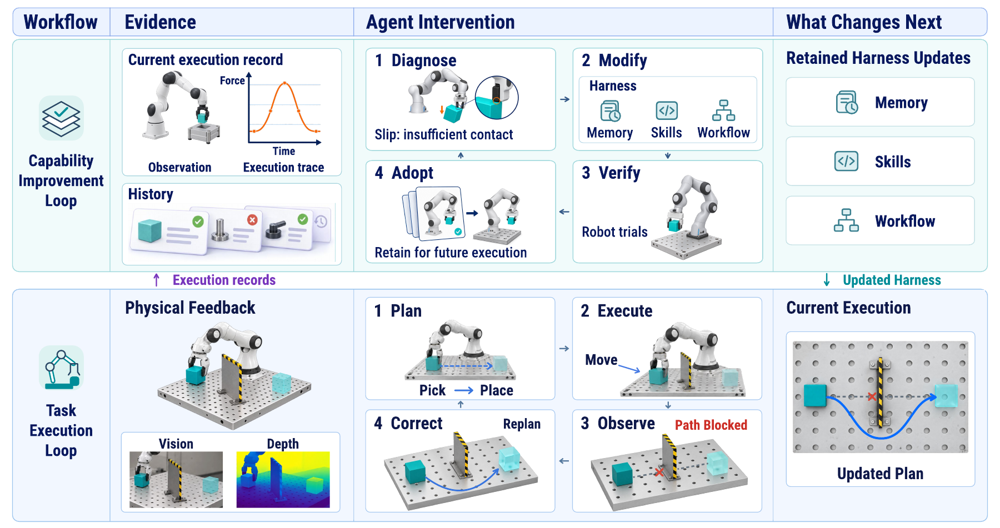
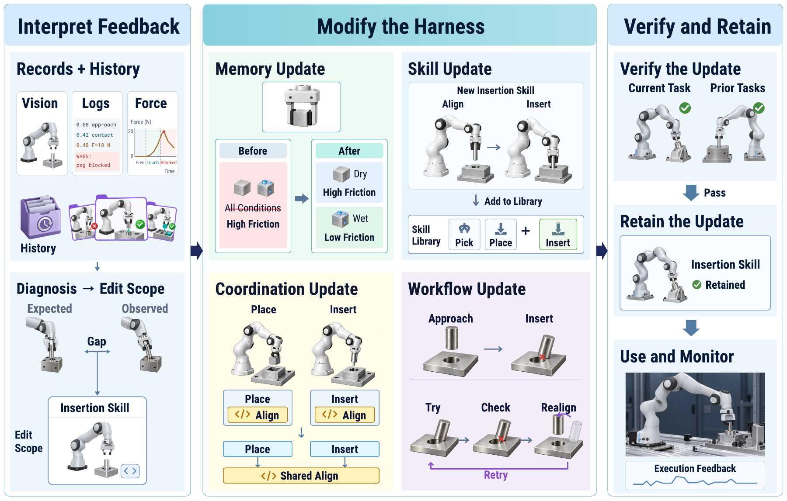
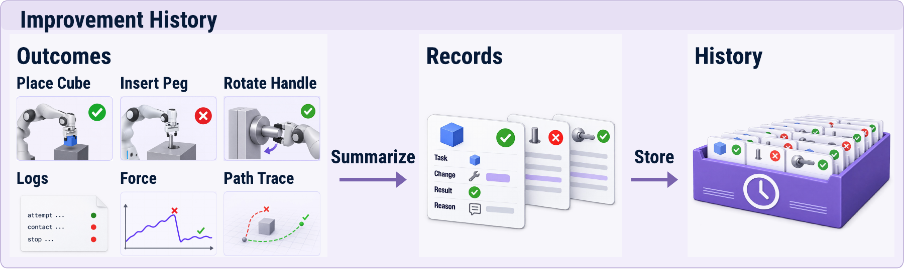
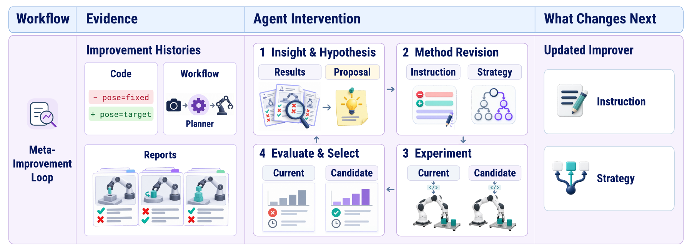

# Harness Adaptation for Physical RSI

[Repository overview](../README.md) · [Original paper reference index](paper-reference-index.md) · [Chapter reference supplement](harness-reference-supplement.md)

This reading guide follows the saved Harness chapter as of **11 October 2026**. It extends the repository's September manuscript snapshot. The original 102-work bibliography count remains unchanged. Mechanisms from digital agents and simulation are identified as such and do not establish physically grounded recursive improvement.

## Execution and capability improvement

The harness supports robot execution through memory, executable skills and programs, and workflows. Environmental representations and retained guidance supply decision context. Programs and skill interfaces expose robot behavior, while workflows govern capability selection, sequencing, and recovery. Representative foundations include [DynaMem](https://arxiv.org/abs/2411.04999), [DROC](https://arxiv.org/html/2311.10678v2), [Code as Policies](https://arxiv.org/abs/2209.07753), [SkiROS2](https://arxiv.org/abs/2306.17030), [SayCan](https://arxiv.org/abs/2204.01691), and [behavior trees](https://arxiv.org/abs/1709.00084).

The task execution loop uses these resources to act and respond to physical feedback. The capability improvement loop uses execution records and modification history to produce retained harness updates. The mechanisms below concern this harness pathway, rather than model-parameter training.

*Execution records inform persistent updates, which support subsequent execution. The task scenes are schematic illustrations of the loops.*

## 1. Feedback interpretation and update targets

Execution records must first support a diagnosis, then a decision about the editable component and scope. A failed attempt alone does not identify the appropriate edit.

| Reasoning step | Mechanism and representative literature |
| --- | --- |
| Connect outcomes to operations | In simulated robot tasks, [ASPIRE](https://arxiv.org/html/2607.00272v1) uses primitive-level traces, [HarnessPAI](https://arxiv.org/html/2609.29166v1) uses workflow-node diagnostics, and [Act-Observe-Rewrite](https://arxiv.org/html/2603.04466v1) uses visual keyframes. |
| Compare attempts and conditions | In digital tasks, [ExpeL](https://arxiv.org/html/2308.10144v3) contrasts successful and failed attempts, while [AutoGuide](https://arxiv.org/html/2403.08978v2) relates corrective guidance to its context. These comparisons support diagnostic hypotheses. |
| Identify an editable target | [AutoManual](https://arxiv.org/html/2405.16247v4) distinguishes defective guidance from failures to follow it. [HarnessFix](https://arxiv.org/html/2606.06324v2) links failures to harness code, while [RACaP](https://arxiv.org/html/2609.29394v1) considers interfaces, exposed parameters, routing, and memory in simulation. |
| Bound the proposed change | [Self-Harness](https://arxiv.org/html/2606.09498v3) favors bounded edits. [SkillAdam](https://arxiv.org/html/2609.08944v1) uses prior editing outcomes to regulate scope, and [RoboFoundry](https://arxiv.org/html/2609.32862v1) distinguishes task-specific repairs from broader changes. |

The output is a diagnosed problem linked to a concrete modification target, intended effect, and scope. Constructing the actual update is a separate step.

## 2. Memory, skills, and workflows

*The four update panels distinguish retained information, individual capabilities, dependencies between capabilities, and execution procedures.*

| Modification object | What changes | Representative mechanisms and scope |
| --- | --- | --- |
| **Memory** | Retained guidance, application conditions, and outdated content | Digital-agent methods include feedback reflections in [Reflexion](https://arxiv.org/abs/2303.11366), cross-attempt insights in [ExpeL](https://arxiv.org/html/2308.10144v3), context-specific guidance in [AutoGuide](https://arxiv.org/html/2403.08978v2), and editable rules in [AutoManual](https://arxiv.org/html/2405.16247v4). In robotics, [PhysMem](https://arxiv.org/html/2602.20323v6) develops and tests interaction-derived hypotheses, while [KnowBody](https://arxiv.org/html/2609.28530v1) revises body relations and rechecks dependent knowledge. |
| **Individual skills and tools** | Implementations, interfaces, or newly constructed capabilities | [ASPIRE](https://arxiv.org/html/2607.00272v1) repairs task programs, while [Act-Observe-Rewrite](https://arxiv.org/html/2603.04466v1) replaces perception or controller code between simulated trials. [LATM](https://arxiv.org/abs/2305.17126) separates tool construction from invocation in digital tasks. [ViReSkill](https://arxiv.org/html/2509.24219v1) retains successful robot plans and control code. |
| **Coordinated updates** | Shared functions and the programs that depend on them | [ReGAL](https://arxiv.org/html/2401.16467v2) introduces helpers while refactoring callers. [Lifelong Robot Library Learning](https://arxiv.org/html/2406.18746v2) extracts parameterized skills and rewrites examples in simulation with human demonstrations and hints. [Playful](https://arxiv.org/html/2606.19419v1) consolidates redundant helpers in simulated robot program libraries. Multiple changed files alone do not establish coordination. |
| **Workflows** | Invocation conditions, handoffs, task progression, and recovery rules | [BATON](https://arxiv.org/html/2608.16889v3) records invocation, handoff, and lookahead conditions. [RoboFoundry](https://arxiv.org/html/2609.32862v1) modifies stage processing and replanning cadence. [RACaP](https://arxiv.org/html/2609.29394v1) evolves its harness in simulation before freezing it for deployment. [Kintsugi](https://arxiv.org/html/2605.09487v1) updates schemas, monitors, and recovery entries between rollouts. |

These mechanisms change resources or procedures available to later executions. Using an existing recovery procedure during a task does not, by itself, demonstrate a retained workflow update.

## 3. Adoption and improvement history

Candidate updates are checked before adoption. [ASPIRE](https://arxiv.org/html/2607.00272v1) re-executes repaired programs, while [ReGAL](https://arxiv.org/html/2401.16467v2) tests programs affected by changes to shared functions. Accepted artifacts can then serve subsequent execution, including plans and code in [ViReSkill](https://arxiv.org/html/2509.24219v1) and library helpers in [Playful](https://arxiv.org/html/2606.19419v1). Continued interaction supplies evidence for continued use, renewed verification, or further modification. See the repository's [verification overview](../README.md#3-verification) for the broader distinction between behavior checks, data admission, and update release.

*Improvement history preserves the connection between a task, the attempted change, its outcome, and the supporting rationale. Both successful and unsuccessful attempts contribute.*

| Recorded information | Representative practice |
| --- | --- |
| Attempts and physical evidence | [ASPIRE](https://arxiv.org/html/2607.00272v1) records experiments, fixes, skill updates, and results. [KnowBody](https://arxiv.org/html/2609.28530v1) preserves observations and actions alongside outcome assessments. |
| Structured changes and decisions | In digital and simulated tasks, [WikiSkill](https://arxiv.org/html/2608.27454v1) records target skills, edit differences, validation scores, and acceptance decisions. [EvoSkill](https://arxiv.org/abs/2603.02766) retains proposals, rationale, and performance changes, including feedback on discarded candidates. |
| Histories across attempts | [SkillAdam](https://arxiv.org/html/2609.08944v1) organizes changes by issue and reopens issues when failures recur. [MCE](https://arxiv.org/abs/2601.21557v2) links context-engineering strategies, generated functions, and evaluation metrics in digital tasks. |

Execution memory supports later task decisions. Improvement history records how updates were attempted and assessed. This history can support both the next modification decision and analysis of the method producing those modifications.

## 4. Meta-improvement of adaptation

Meta-improvement changes **Adapt**, the method that generates subsequent harness updates. [Gödel Machines](https://arxiv.org/abs/cs/0309048v5) provide a formal precedent, while [STOP](https://arxiv.org/pdf/2310.02304v3) and [Hyperagents](https://arxiv.org/html/2603.19461v1) implement editable improvement procedures in digital systems. These precedents motivate studying method revision in Physical RSI without establishing its physical benefits.

*Candidate methods are assessed through the subsequent updates they produce. Robot scenes illustrate the intended physical evaluation setting, not empirical results of the digital studies below.*

| Method-level object | Supporting mechanisms in digital systems |
| --- | --- |
| Optimizer guidance | [SkillOpt](https://arxiv.org/html/2605.23904v2) consolidates editing experience into an optimizer-side meta skill. [Promptbreeder](https://proceedings.mlr.press/v235/fernando24a.html) evolves mutation prompts according to the performance of their generated task prompts. |
| Resource-construction operations | [MemSkill](https://arxiv.org/abs/2602.02474v2) refines memory-construction skills using difficult cases. [MCE](https://arxiv.org/abs/2601.21557v2) evolves context-building strategies from prior strategies and evaluations. [ALMA](https://arxiv.org/abs/2602.07755v1) searches designs containing memory-update functions. The changed object is the operation producing memory, not simply additional memory content. |
| Update-generating programs | [VERSE](https://arxiv.org/abs/2610.02616v1) modifies optimizer-side diagnostic tools and calls to checks. [STOP](https://arxiv.org/pdf/2310.02304v3) and [Hyperagents](https://arxiv.org/html/2603.19461v1) expose the improvement procedure itself to revision. |

Method evaluation concerns downstream update quality and cost. STOP evaluates generated programs, while Hyperagents and [SelfSearch](https://arxiv.org/html/2609.37968v2) include fixed-improver comparisons. [VERSE](https://arxiv.org/abs/2610.02616v1) reports that method evolution does not improve every setting. When runtime components and adaptation methods change together, as in [MemEvolve](https://arxiv.org/html/2512.18746v1) and ALMA, attribution requires particular care. Findings on [reward hacking in digital research tasks](https://arxiv.org/abs/2609.28614) also motivate evidence independent of the candidate's own measurement process.

For Physical RSI, matched initial systems, experience, and budgets should determine whether a revised method produces better later updates. Adoption must make that method govern subsequent improvement attempts. [HSI](https://arxiv.org/abs/2608.08466v1) executes revised evolution strategies in later rounds, while VERSE uses checks and a test run before replacing its optimizer. Physical outcomes of the resulting harness updates must return to improvement history. Inherited method changes establish recursion in structure, but beneficial recursion additionally requires evidence that those revisions improve later adaptation.

## Source and maintenance notes

- This page is a repository reading guide derived from the saved Harness chapter, not a replacement for the full manuscript or its verification section.
- The [chapter reference supplement](harness-reference-supplement.md) lists all works cited in that saved chapter, including works not individually discussed here. Overlap with the original index is expected.
- Figures are PNG renderings of the corresponding saved chapter PDFs. Illustrations explain mechanisms and do not substitute for experimental evidence.
- No new L1–L5 capability assignments are made by this supplement. Study scope and the repository's evidence boundaries remain applicable.
